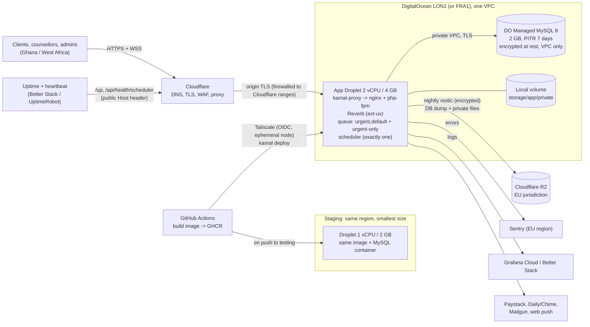

# Deployment options: staging and production (SCRUM-466)

Planning document only. Nothing here changes infrastructure, code or config. Prices were checked on
**2026-11-22** unless a row says otherwise. A price marked **(unverified)** could not be confirmed on the
provider's own page or price API that day, so confirm it before relying on it. Nothing marked
**(legal)** should be treated as settled until a Ghanaian data-protection lawyer has confirmed it.

## 1. Executive summary

**Recommendation: one provider for the app and the database, in one European region. Use other
providers only at the edges.**

- **Production:** DigitalOcean **LON1 (London)**, or FRA1 if the Accra latency test (ticket T1) favours it.
  - One Droplet (2 vCPU / 4 GB) running the app as containers: nginx + php-fpm, Reverb, the queue workers
    and the scheduler.
  - **DO Managed MySQL 8** (2 GB, single node), with daily backups and 7-day point-in-time recovery (PITR)
    included, encryption at rest, and access only from the private VPC.
  - About **US$59/month** at launch, and about **US$225–240/month** at 10× (section 10).
- **Staging:** the same provider and region, at the smallest size: a US$12 Droplet, with MySQL in a container
  (US$12/month). Add US$15/month for a managed 1 GB cluster if staging should use the same database
  service as production. Deployed automatically from `testing`.
- **Edges, where mixing providers pays:**
  - **Cloudflare** in front: DNS, TLS, WAF. The production checklist already plans for a CDN proxy
    (`TRUSTED_PROXIES`).
  - **Cloudflare R2** with an EU jurisdiction bucket: encrypted off-provider copies of the database dumps
    and of `storage/app/private`. R2 charges nothing for egress, so a restore costs nothing.
  - **SaaS monitoring** on free tiers: Sentry, Better Stack or UptimeRobot, and Grafana Cloud.
- **Deploys:** images built in GitHub Actions and pushed to GHCR, then **Kamal 2** to the hosts.
  - CI reaches the hosts over **Tailscale with GitHub OIDC** (workload identity federation). No SSH port is
    open to the internet, and no long-lived cloud key is stored in CI. This replaces the EC2 workflow's
    `ACCESS_KEY` / `SECRET_ACCESS_KEY` secrets.
  - The current maintenance-mode deploy (`scripts/deploy.sh`) stays available for releases with
    migrations that aren't backward-compatible.
- **Don't:**
  - Put the app and the database at different providers. Laravel issues many sequential queries per
    request, so every millisecond of round trip is multiplied.
  - Use **PlanetScale (Vitess)**. It doesn't support triggers, and the append-only audit tables depend on
    them (SCRUM-362, six migrations).

**Gating checks before committing:**

1. **Database compatibility spike (T2).** The migrations create triggers, so they need
   `log_bin_trust_function_creators=1` or an equivalent privilege. DO's documentation doesn't say whether
   a managed cluster allows this. Run `php artisan migrate` against a trial cluster.
   - If it fails, fall back to option C (AWS RDS: the flag is set in a parameter group) or option B
     (MySQL that we run ourselves).
   - The same spike checks DO's `sql_require_primary_key` default. Three migrations use `->primary(...)`.
2. **Latency from Accra (T1).** No published Accra-to-region measurement was found. Measure London,
   Frankfurt, Amsterdam, Nuremberg/Falkenstein, Cape Town and Johannesburg before choosing the region.
3. **Legal review (T15)** of where data may be hosted (section 8).

**Ranked options (details in sections 3 and 10):**

| # | Option | Launch / month | 10× / month | Why / why not |
|---|---|---|---|---|
| **A** | **DigitalOcean LON1/FRA1**: Droplet + Managed MySQL + R2 | **≈ US$59** | **≈ US$225** (single-node DB) | Cheapest option that includes a managed database with PITR. Simple. No African region. HA for **new** clusters needs Advanced Edition from 30 Nov 2026 (price unverified). Trigger support not yet verified. |
| B | **Hetzner NBG1/FSN1**: VMs + MySQL we run ourselves + R2 | **≈ €38** | **≈ €186** + US$32 | Cheapest by far. No managed MySQL, so we own backups, binlog PITR, replicas and patching. Only worth it if someone owns database operations. |
| C | **AWS eu-west-2 (London)**: EC2 + RDS + R2 | **≈ US$58** + unverified storage/IPv4 | **≈ US$401** + unverified ALB/storage | About the same as A at launch. Native OIDC, SSM, Multi-AZ at small sizes, and triggers via a parameter group. Egress at US$0.09/GB makes it the most expensive at 10×. Also the fallback if the A spike fails. af-south-1 (Cape Town) costs more again (≈ US$525 at 10×). |

## 2. What the stack needs

From `docker-compose.yml`, `docker/`, `scripts/deploy.sh`, `.env.docker.example`, `config/*.php` and
`routes/console.php`:

| Concern | Today (Docker dev / EC2) | What production needs |
|---|---|---|
| Web | nginx + php-fpm (`web`, `php`) | Same. TLS at Cloudflare and/or the proxy. Real client IPs via `TRUSTED_PROXIES` (production checklist). |
| Frontend | `vite` dev server; `npm run build` on the EC2 box during deploy | Assets built **in CI** into the image, with no Node on the servers. The `vite` service is dev-only. |
| Database | MySQL 8.0 with `--log-bin-trust-function-creators=1` (SCRUM-362 triggers) | MySQL 8, with the flag or an equivalent. **Triggers required** (6 migrations), so no Vitess/PlanetScale. InnoDB REPEATABLE READ assumed (SCRUM-467 overlap check). |
| Queue | `QUEUE_CONNECTION=database`; Supervisor runs `queue:work --queue=urgent,default` plus a dedicated `urgent` worker | Same command lines. The urgent worker is mandatory (SCRUM-399). The database queue is fine for both launch and 10×. |
| Scheduler | `schedule:work` inside the `queue` container (SCRUM-333) | Must run **exactly once** across the fleet. It runs every minute (urgent-help sweep, two-factor resets). |
| Websockets | Reverb (`reverb:start`, port 8081), one process | One process covers launch and 10×. Over ~1,000 concurrent connections it needs `ext-uv` (Laravel docs). Horizontal scaling needs Redis pub/sub. |
| Cache / session | `CACHE_DRIVER=file`, `SESSION_DRIVER=file`; the scheduler has its own file store (SCRUM-373) | Fine on a single app node. With **more than one web node**, sessions and cache must be shared (database or Redis). `onOneServer()` needs a database/memcached/dynamodb/redis cache (Laravel docs), and the checklist already asks for a shared store when there are several workers or web nodes (push withdrawal, journal-export lock). |
| Redis | **Not used.** No `predis` in `composer.json`, no `redis` extension in `docker/php/Dockerfile` | Not needed at launch. Needed only for Reverb horizontal scaling, and optionally for sessions and cache at several nodes. Adding it is a code and image change (T11). |
| Files | **Local disks only**: `public`, plus four private disks (`identity_documents`, `license_documents`, `message_attachments`, `report_evidence`) under `storage/app/private`. The `s3` disk is defined, but `league/flysystem-aws-s3-v3` isn't installed. | One app node: a local volume plus encrypted off-provider backups. More than one web node: move the private disks to S3-compatible storage (code change, T12). |
| Mail | Mailpit in dev; Mailgun for deployed environments (SCRUM-413, EU endpoint commented in the example) | Mailgun (or similar), outside the cloud choice. |
| External | Paystack (GHS/USD), Daily or Chime video, web push (FCM/Mozilla/Apple/Microsoft), Have I Been Pwned, Bunny Fonts | Outbound HTTPS from the app and workers. Video media doesn't pass through our servers, so it adds no egress. |
| Health checks | `/up`, `/api/health/scheduler` (needs the public Host header, SCRUM-397) | A load balancer or uptime probe that sends the public Host header. |
| Deploy | GitHub Actions → AWS SSM Run Command → `scripts/deploy.sh` on one EC2 box (`eu-north-1`, Stockholm). Maintenance mode for the whole deploy; long-lived IAM keys in repo secrets | See section 6. The OIDC follow-up from SCRUM-407 is folded into this plan. |

**Current state:** the decision log (SCRUM-292 entry) records the user's note that "there is no production
deployment or data yet". SCRUM-412 isn't referenced anywhere in the repo, so the readiness context here
comes from SCRUM-411/413. Those entries say `testing` → `main` stays gated on SCRUM-364 (privacy legal
review) plus production env, backups and restore, alert transport and Dependabot alerts.

## 3. Candidates and prices

Monthly figures are the hourly rate × 730 h where only an hourly rate is published. All prices are in the
provider's own currency and exclude VAT/tax. Accessed 2026-11-22.

### 3.1 Compute (one 2 vCPU / 4 GB node, the launch size)

| Provider / region | Plan | vCPU / RAM | Monthly | Egress included / overage | Source |
|---|---|---|---|---|---|
| **Hetzner** NBG1 (Nuremberg) | CPX22 | 2 / 4 GB, 80 GB NVMe | **€19.99** (NBG1 only; €16.99 in HEL1) | 20 TB included; €1/TB over | hetzner.com/cloud/regular-performance |
| Hetzner NBG1/FSN1 | CPX12 | 1 / 2 GB | €11.99 (HEL1 €9.99) | 20 TB | same |
| Hetzner NBG1/FSN1 | CPX32 | 4 / 8 GB | €35.99 | 20 TB | same |
| Hetzner | Backups | 7 slots | 20% of the server price (**inferred**: the page's "from €1.098" is 20% of the €5.49 base plan) | — | same |
| **DigitalOcean** LON1/FRA1/AMS3 | Basic 4 GiB | 2 / 4 GiB, 80 GiB | **$24.00** | 4,000 GiB pool; overage rate not shown **(unverified)** | digitalocean.com/pricing/droplets |
| DigitalOcean | Basic 2 GiB / 8 GiB | 1/2 GiB; 4/8 GiB | $12.00 / $48.00 | 2,000 / 5,000 GiB | same |
| DigitalOcean | Backups | weekly / daily | 20% / 30% of the Droplet price | — | same |
| **Akamai (Linode)** | Linode 4 GB | 2 / 4 GB, 80 GB | $24.00 | 4 TB; $0.005/GB over | akamai.com/cloud/pricing/cpu |
| **AWS** eu-west-2 London | t4g.medium (burstable, Graviton) | 2 / 4 GiB | **$27.45** ($0.0376/h) + EBS + public IPv4 **(rates unverified)** | 100 GB/month free (all of AWS); then $0.09/GB | AWS price API (`b0.p.awsstatic.com`), S3 pricing page |
| AWS eu-west-1 Ireland / eu-central-1 Frankfurt | t4g.medium | 2 / 4 GiB | $26.86 / $28.03 | $0.09/GB | AWS price API |
| AWS eu-north-1 Stockholm (today's EC2 region) | t4g.medium | 2 / 4 GiB | $25.11 | $0.09/GB | AWS price API |
| AWS af-south-1 Cape Town | t4g.medium | 2 / 4 GiB | $31.68 | **$0.154/GB** | AWS price API |
| **GCP** europe-west1 / europe-west2 / africa-south1 (Johannesburg) | e2-medium | 2 shared / 4 GB | $26.91 / $31.51 / $26.91 (third-party aggregator, **unverified** against Google) | not checked **(unverified)** | gcloud-compute.com (updated 2026-11-22) |
| **Azure** West Europe / UK South / South Africa North | B2als_v2 | 2 / 4 GiB | $31.54 / $31.03 / $35.62 | not checked **(unverified)** | Azure Retail Prices API |
| **OVHcloud** | VPS-1 | 2 vCore / 4 GB, 40 GB | "from" $4.54 (likely needs a commitment; locations not shown) **(unverified)** | Unlimited traffic, 500 Mbps | ovhcloud.com/en/vps |
| **Fly.io** | shared-cpu-2x 2 GB | 2 shared / 2 GB | $13.39 (iad; other regions differ) | Europe $0.02/GB; **Africa $0.12/GB** | docs.fly.io/about/pricing |
| **Render** | 2c-4g | 2 / 4 GB | $85 + workspace (Pro $25) | 25 GB (Pro); $0.15/GB over | render.com/pricing.md |
| **Railway** | usage | per vCPU/GB | ≈ $20/vCPU + $10/GB RAM per month (2/4 ≈ $80) + plan ($5 Hobby / $20 Pro) | $0.05/GB | railway.com/pricing |

Notes:

- **Staging that can "sleep".**
  - Hetzner, DO and Linode bill a powered-off VM in full. Only deleting it (keeping a snapshot) stops the
    bill.
  - AWS and GCP stop charging compute when the instance is stopped (EBS still billed). At about
    260 h/month (working hours), a t4g.small comes to **$4.89**.
  - Fly.io stops billing a stopped Machine except its root filesystem ($0.15/GB-month).
  - Railway's Free plan sleeps idle services. Its Hobby and Pro plans don't.
- **PaaS fit.**
  - Render has **no managed MySQL** (Postgres only), so the database would sit at another provider. That
    is the cross-provider split this plan advises against.
  - Fly.io has no managed MySQL either: its managed database is Postgres.
  - Railway's MySQL is a template container that we would run and back up ourselves.
  - With PHP-FPM, Reverb, two queue workers and the scheduler, the PaaS options cost 3–4× a VM. Laravel
    Cloud wasn't priced.

### 3.2 Managed MySQL

| Service / region | Smallest useful plan | Monthly | Backups / PITR | Triggers (`log_bin_trust_function_creators`) | Source |
|---|---|---|---|---|---|
| **DO Managed MySQL** (LON1/FRA1/AMS3) | 1 GiB / 1 vCPU, 10–30 GiB | **$15.15** | Daily backups free; **PITR 7 days** | **Not documented.** System variables can't be edited ("you can view them"); config requests go through the API. **Verify (T2).** | digitalocean.com/pricing/managed-databases; DO limits doc |
| DO Managed MySQL | 2 GiB / 1 vCPU, 30–60 GiB | **$30.45** | same | same | same |
| DO Managed MySQL | 4 GiB / 2 vCPU, 60–120 GiB | $60.90 | same | same | same |
| DO: HA | Standard Edition standby = same price as the primary, but **from 30 Nov 2026 new Standard clusters can't add standby nodes or plans over 4 GiB**. HA then needs **Advanced Edition**, where the smallest shared plan is 8 GiB (price shown only at creation) **(unverified)**. Clusters created earlier keep these options. | — | — | — | DO pricing doc; DO release note "PostgreSQL and MySQL Plan Changes Beginning 15 October 2026" |
| **AWS RDS MySQL** eu-west-2 London | db.t4g.micro (1 GiB) Single-AZ / db.t4g.small (2 GiB) Single-AZ | $13.14 / **$26.28** + storage **(unverified)** | Automated backups with PITR (retention configurable; standard RDS behaviour) | **Yes**, via a custom parameter group (RDS knowledge centre; already in the README) | AWS price API |
| RDS London | db.t4g.small Multi-AZ / db.t4g.medium Multi-AZ | $52.56 / **$105.85** | same | same | AWS price API |
| RDS af-south-1 Cape Town | db.t4g.small SAZ / db.t4g.medium MAZ | $29.93 / $119.72 | same | same | AWS price API |
| RDS eu-north-1 Stockholm | db.t4g.small SAZ | $24.09 | same | same | AWS price API |
| **Aiven for MySQL** (AWS, GCP, Azure, DO, OVH, UpCloud) | Hobbyist 1 GB (DO/GCP/OVH) / Startup 4 GB / Business (2 nodes, HA) | $19 / **$75** / $180 ("from"; varies by cloud and region) | Hobbyist: a single backup, disaster recovery only. Startup: PITR 2 days. Business: PITR 14 days | Not found in the docs **(unverified)** | aiven.io/pricing/mysql |
| **Akamai Managed MySQL** | Shared 1 GB, 9 GB usable | $16 (1 node) / **$37 (3 nodes)** | Not stated on the pricing page **(unverified)** | **(unverified)** | akamai.com/cloud/pricing/databases |
| **GCP Cloud SQL MySQL** | db-g1-small (shared core, no SLA) | ≈ $26 in europe-west1 (third-party, **unverified**) | Backups + PITR (standard) | Cloud SQL exposes the flag as a database flag (standard behaviour, **unverified** here) | bytebase.com/dbcost (updated 2026-07-20) |
| **Azure MySQL Flexible** West Europe | B1ms / B2s burstable | $14.53 / $58.11 + storage $0.1369/GB | Backup storage $0.103/GB | Defaults to **ON** (Microsoft docs, via search) | Azure Retail Prices API |
| **PlanetScale (Vitess)** | PS-10, 3-node HA only | $39 | Billed separately | **No.** "We do not support any form of stored routines" (procedures, functions, **triggers**, events). Direct DDL is blocked on production branches when safe migrations are on. | planetscale.com/pricing; PlanetScale MySQL compatibility doc |
| Hetzner | — | No managed MySQL found on Hetzner Cloud's pages | — | — | hetzner.com/cloud |

**PlanetScale is ruled out.** SCRUM-362 and later tickets made the confidential-message access log and
four more tables append-only with triggers (`cma_no_*`, `aca_no_*`, `cve_no_*`, `ene_no_*`, `sfn_*`).
Vitess has no triggers, and it doesn't support MySQL's own user and privilege management. Foreign keys
were not on the compatibility page fetched, so they are not assessed here. The app relies on FK
restrict rules (for example, SCRUM-467 waivers).

### 3.3 Object storage (backups, and later the private disks)

| Service | Storage | Egress | Requests | Free tier | Residency | Source |
|---|---|---|---|---|---|---|
| **Cloudflare R2** | $0.015/GB-month (Standard) | **Free** | A $4.50/M, B $0.36/M | 10 GB-month, 1M A, 10M B | **EU jurisdiction** guarantees EU storage; no Africa location hint | developers.cloudflare.com/r2/pricing, …/data-location |
| **Backblaze B2** | $6.95/TB-month | Free up to 3× stored, then $0.01/GB | Classes A–C free; D $0.004/10k | First 10 GB | Regions not shown on the pricing page | backblaze.com/cloud-storage/pricing |
| **AWS S3 Standard** | $0.023 (Ireland), $0.0245 (Frankfurt), $0.0274 (Cape Town) per GB-month | $0.09/GB (EU), $0.154/GB (Cape Town), after 100 GB free | GET $0.0004/1k | — | Per region | AWS price API, S3 pricing page |
| Hetzner Object Storage | €6.49/month including 1 TB stored + 1 TB egress | €1/TB over | — | — | FSN1, NBG1, HEL1; object lock supported | hetzner.com/storage/object-storage |
| DO Spaces | "from $5/month"; included amounts not shown **(unverified)** | — | — | — | LON1, FRA1, AMS3 | digitalocean.com/pricing |

### 3.4 Region and latency to Ghana / West Africa

- **No hyperscaler region in West Africa.** The closest African regions are AWS af-south-1 (Cape Town),
  GCP africa-south1 (Johannesburg) and Azure South Africa North. DigitalOcean (16 datacentres) and Hetzner
  (Germany, Finland, US, Singapore) have none in Africa.
- **Routing may favour Europe over South Africa.** Cloudflare's RIPE Atlas study found that traffic to and
  from Ghana mostly exchanged in Europe (Paris, London, Lisbon, Marseille). Only one traceroute crossed
  South Africa. That study is from **2018**, so it is dated.
  - Region-to-region figures put Cape Town ↔ Frankfurt/Ireland at about **155–160 ms**
    (economize.cloud, third-party).
  - No published Accra → London/Frankfurt/Cape Town figure was found. **All latency claims here are
    unverified.**
- **Action (T1):** measure from Accra (a home and a mobile connection, or RIPE Atlas probes in Ghana) to a
  test VM or the providers' speed-test endpoints in LON1, FRA1, AMS3, NBG1/FSN1, eu-west-2, af-south-1 and
  africa-south1. Pick the lowest p50/p95.
  - Expectation, to be confirmed: London or Frankfurt will be within a few tens of milliseconds of Cape
    Town, at lower cost and egress.
  - Video is unaffected either way: Daily and Chime media go to their own edges.

## 4. Mixing providers

| Dimension | App and DB at **different** providers | Edges at different providers (CDN, object storage, monitoring) |
|---|---|---|
| **Latency** | Even "same metro" cross-provider links add a few milliseconds a round trip **(unverified; measure)**. A Laravel page making 30–60 sequential queries turns 3 ms into 90–180 ms per request. The urgent-help sweep and the queue workers feel it too. | None on the request path (backups are asynchronous; Cloudflare sits in front anyway). |
| **Egress** | Every query result crosses the public internet. AWS charges $0.09/GB out; DO and Hetzner include generous pools. Two meters to watch. | R2 egress is free, so restores and downloads cost nothing. B2 is free up to 3× stored. |
| **Private networking / TLS** | No shared VPC. Needs TLS to the database (`MYSQL_ATTR_SSL_CA` in `config/database.php` options) **plus** an IP allowlist, or WireGuard/Tailscale between the providers (another daemon on the critical path, another thing that can go down). | HTTPS APIs. Nothing to run. |
| **Backups / PITR** | The managed database's PITR still works. Restores cross providers. | Off-provider backup copies are the **main benefit**: an account compromise or billing lock at the main provider doesn't take the backups with it. |
| **Failure domains** | **Worse:** the app depends on two providers' uptime (availability multiplies, e.g. 99.9% × 99.9% ≈ 99.8%) plus the link between them. | Better for backups (independent). Cloudflare becomes a dependency for serving, which is acceptable and common. |
| **Operational burden** | Two consoles, two bills, two sets of credentials, an allowlist to keep in sync, split incident triage. Heavy for a one-person team. | Low: set up once, mostly free tiers. |
| **Verdict** | **Don't**, unless the database provider and the app provider share a metro **and** a measured round trip is under ~1 ms. Re-assess only if HA becomes a requirement and is cheaper elsewhere. | **Do**: Cloudflare (DNS/TLS/WAF), R2 (backups, later the private disks), Sentry / Better Stack / Grafana. |

Other mixes considered:

- **Staging on Hetzner, production on DO.** Saves about $0–3/month against a $12 DO Droplet, but staging
  would stop mirroring production's network, images and backup behaviour. Not worth it.
- **Compute at Hetzner, database at Aiven on DO Frankfurt.** Hetzner's cheap compute is cancelled out by
  Aiven Startup's $75, and the app pays the cross-provider latency above. Not worth it.

## 5. Recommended setup

**At 10×**, the same design with these changes:

- Two web Droplets (4 vCPU / 8 GB) behind a DO load balancer.
- One worker Droplet running the queue workers and the scheduler. The scheduler runs **only** there.
- Sessions and cache switch to `database` (or Valkey/Redis if T11 is done).
- The private disks move to R2 or S3-compatible storage (T12).
- MySQL grows to 4 GB. If HA is required, use Advanced Edition (price unverified), or re-evaluate RDS
  Multi-AZ.
- Reverb can stay a single process (2,000 connections fits one process with `ext-uv`). Redis scaling is
  only needed beyond one process.

## 6. Deployment approach

### 6.1 Tooling

| Approach | Fit | Notes |
|---|---|---|
| **Docker Compose on a VM** | Good for one node | Closest to dev. But today's `docker-compose.yml` is dev-only: bind mounts, the `vite` dev server, Mailpit, the root DB password, entrypoint migrations. A production compose file or image is needed either way (T4). No zero-downtime switching on its own. |
| **Kamal 2** (current docs 2.12.0) | **Recommended** | Docker based. kamal-proxy does "gapless deployments" with an `/up` health check, automatic Let's Encrypt (or Cloudflare origin certificates) and multi-host *roles*, which map well to web / worker / reverb. Secrets come from `.kamal/secrets` adapters. Free and open source. WebSocket pass-through for Reverb on kamal-proxy still to be checked in T5 **(unverified)**. |
| **Coolify** | OK | Self-hosted is free; Coolify Cloud is $5/month (2 servers) + $3 per extra server. A UI is convenient, but it is another internet-facing control plane holding every secret. |
| **Nomad / k3s** | Overkill | A cluster scheduler for 1–4 nodes adds more operational work than it removes. Revisit at more than about 6 nodes. |
| **PaaS** (Render, Railway, Fly) | Poor | No managed MySQL (Render, Fly), 3–4× the compute cost, and four long-running process types to model. |

### 6.2 Adding nodes

1. Before the second web node:
   - sessions and cache on `database` (or Redis);
   - private disks on object storage (T12);
   - a load balancer (DO LB from $12) or Cloudflare load balancing (not priced);
   - `TRUSTED_PROXIES` updated.
2. Add a Kamal `worker` role host. Run the queue workers and **the scheduler there only**. The web role
   runs no scheduler.
3. Reverb: keep one process on one host behind the proxy's `/app` and `/apps` paths. Only when one process
   isn't enough:
   - set `REVERB_SCALING_ENABLED=true` with a central Redis;
   - run Reverb on several hosts behind a load balancer.
   A WebSocket stays on the node it connected to, so no sticky sessions are needed at the HTTP level.
   Reverb's Redis pub/sub fans messages out, and the Pusher protocol's REST API calls (`/apps`) can hit
   any node.
   - Raise `ulimit -n`, nginx `worker_connections` and Supervisor `minfds`, and install `ext-uv` once over
     1,000 connections (Laravel docs).

### 6.3 Scheduler exactly once

- Today the scheduler runs as `schedule:work` inside the single `queue` container. That stays correct as
  long as exactly **one** host or container runs it. Make this structural: a single-replica Kamal
  `scheduler` role, or a process only in the worker role.
- `onOneServer()` is already on most entries (`routes/console.php`). It protects nothing while the default
  cache is `file`, because each host has its own lock file. Laravel requires a database/memcached/dynamodb/
  redis cache for it.
- If a second scheduler ever runs by mistake (say, during a blue/green overlap), the guard needs a shared
  store. Move `CACHE_STORE` and `SCHEDULER_CACHE_STORE` to `database` as part of T10. Keep the scheduler
  store separate from the default store, so a deploy's `cache:clear` doesn't wipe the once-only keys
  (SCRUM-373).
- Heartbeat: an external monitor polls `/api/health/scheduler` (section 9).

### 6.4 Zero-downtime deploys and migrations

- **Today:** `scripts/deploy.sh` runs `artisan down` for the whole deploy, builds on the box, runs
  `migrate --force` as the web user, then restarts the queue and Reverb. Downtime is deliberate: SCRUM-341
  relies on no request running new code before its migrations.
- **Proposed, two modes:**
  1. **Standard deploy (zero downtime)** for releases whose migrations are backward-compatible (additive,
     expand/contract):
     - CI builds the image.
     - `kamal deploy` runs a pre-deploy hook: a one-off container from the **new** image runs
       `php artisan migrate --force` once, as the web user, against the database.
     - kamal-proxy switches traffic once the new container answers `/up`.
     - Then `queue:restart`, `reverb:restart` and `schedule:interrupt`.
  2. **Maintenance deploy** for releases flagged as breaking:
     - `artisan down` on the running container, migrate, deploy, `artisan up`.
     - Equivalent to today's behaviour, and kept for data migrations such as SCRUM-437 (note
       encryption, measured at 300–500 rows/s) and table-copy DDL such as SCRUM-467's foreign keys.
- **The checklist rules still apply:**
  - The release PR states which mode it needs.
  - Roll back the code, not migrations (see the per-ticket notes in `production-checklist.md`).
  - Never rotate `APP_KEY` in the same deploy.
- Port the guards from `deploy.sh`:
  - the commit must be on `origin/main`;
  - one deploy at a time (`concurrency: production-deploy`);
  - storage ownership for the private disks (`www-data`, `ug+rwX,o-rwx`, setgid);
  - the leftover-public-files warning.
  These become the image entrypoint and a Kamal hook (T5). Root never runs PHP.

## 7. Environments and secrets

| | Local | Staging | Production |
|---|---|---|---|
| Branch | feature/* | **`testing`** (deploys on push; today nothing deploys from `testing`) | **`main`** (deploys on push, as now) |
| Size | Docker Compose | 1 vCPU / 2 GB Droplet, MySQL container (or 1 GB managed) | Section 5 |
| `APP_ENV` | `local` | `staging`. Never `local`/`testing`, which turn the trusted-host check off | `production` |
| Data | seeders | **Seeded demo data only. Never a copy of production data** (health data, minors) | real |
| Third parties | test keys, Mailpit | Paystack **test** keys, a Daily test domain or `VIDEO_PROVIDER=daily` with a separate room prefix, a Mailgun sandbox or subdomain, its own Google OAuth redirect URI, its own VAPID keys | live keys |
| `APP_KEY` / `APP_PREVIOUS_KEYS` | dev | its own | its own, backed up **apart from** the database (journal, notes and 2FA can't be read without it) |

Promotion stays `develop` → `testing` → `main` through PRs (CLAUDE.md). The only new behaviour is that a
merge into `testing` now deploys staging, so staging is the real pre-production gate.

**Secrets with no long-lived cloud keys in CI:**

- **Reaching the hosts:** the Tailscale GitHub Action with **workload identity federation**:
  - the job needs `permissions: id-token: write`;
  - no auth key is stored;
  - an ephemeral, tagged node is removed after the job;
  - tailnet ACLs allow that tag to reach only the deploy hosts on SSH.
  The hosts expose no SSH to the internet, which matches the SSM posture of today.
- **Image registry:** GHCR with the job's `GITHUB_TOKEN` (short-lived, `packages: write` only on the build
  job).
- **Cloud APIs:** provisioning (OpenTofu/Terraform, T3) runs from a maintainer's machine, not CI, so CI
  holds **no** DigitalOcean token. DigitalOcean has no documented GitHub OIDC federation (only a
  proof-of-concept tutorial). **If option C (AWS) is chosen:** `aws-actions/configure-aws-credentials` with
  `role-to-assume` (OIDC), which closes the SCRUM-407 follow-up. GCP and Azure support OIDC federation too.
- **App secrets** (`APP_KEY`, DB password, Paystack, Daily/Chime, Mailgun, VAPID, Google OAuth, Reverb app
  secret):
  - Keep them in a password manager vault that Kamal's secrets adapters read at deploy time, or in a
    root-owned `0600` env file per environment on the host.
  - Never commit them. `.env.docker` is already untracked (commit e05ecdf).
  - Use one file per environment, generated from `.env.docker.example`.
  - The production checklist is the source of truth for the values.
- **Per-environment `.env`:** after this change, `.env.docker` stays local-only. Staging and production get
  `config/deploy.staging.yml` and `config/deploy.yml` (Kamal) with `env.clear` for non-secrets and
  `env.secret` for secrets. That way, differences between environments are reviewable in git without
  exposing values.

## 8. Data and compliance

**Legal confirmation is needed for every item marked (legal).**

- **Who:** TalkTherapy GH, in Ghana, is the data controller under the Data Protection Act, 2012 (Act 843),
  as the privacy page (`resources/js/Pages/Privacy.vue`, SCRUM-364) says.
- **Special personal data:**
  - Health and physical/mental condition are "special personal data" under the Act (DLA Piper summary,
    updated 18 Mar 2026). The platform also holds identity documents and minors' data. Children's
    privacy is otherwise addressed in the Children's Act, 1998 (Act 560).
  - Hosting choices should assume the strictest reading.
- **Cross-border transfer (legal):**
  - DLA Piper (Mar 2026) says Act 843 has "no specific provisions" on transferring personal data abroad.
  - A Templars guide reads it as needing data-subject consent plus appropriate safeguards.
  - Section 18 requires data about **foreign data subjects** to be processed in line with *their*
    jurisdiction's law. That matters for users elsewhere in West Africa: Nigeria's Data Protection Act
    2023, for example, has its own transfer rules.
  - A draft **Data Protection Bill, 2025** (Ministry of Communications) would repeal Act 843, adds a
    cross-border section, and lists health records and children's data as sensitive. Its status is unknown.
  - No in-country hyperscaler region exists. Every option here stores data **outside Ghana** (EU/UK, or
    South Africa).
  - **Questions for counsel:**
    1. Is hosting in the UK/EU or South Africa permitted for this data?
    2. Is consent at sign-up needed or enough?
    3. What processor contract terms are required?
    4. Does UK vs EU vs South Africa make a difference?
    5. What does the 2025 Bill change if enacted?
- **Data Protection Commission registration (legal):**
  - Controllers must register.
  - Registration is valid for **two years** and renewed under section 50; apply three months before
    expiry (DPC guidance, DLA Piper).
  - Fees aren't published online.
  - The DPC is actively enforcing: it registered 2,575 controllers in 2026 and has referred non-renewals
    for prosecution (GNA, Oct 2026; Graphic).
  - **Registration should be confirmed before go-live.** It isn't recorded anywhere in the repo.
- **Breach notification:** notify the Commission and the data subject "as soon as reasonably practicable".
  The monitoring and alerting in section 9 is part of meeting that.
- **Encryption at rest:**
  - DO Managed MySQL says data is encrypted at rest and in transit. R2 stores objects encrypted (Cloudflare
    documentation; not re-checked on the pages fetched).
  - At the application level, `APP_KEY` already encrypts session and message notes (SCRUM-437), journal
    entries (SCRUM-36), check-in answers, 2FA secrets and push subscriptions.
  - **Gap:** files on the private disks (identity, licence, chat attachments, report evidence) are plain
    files on the Droplet volume. Droplet-volume encryption at rest is **unverified**. T13 covers checking
    it, or encrypting the volume (LUKS), or encrypting files at the application level when moving them to
    object storage.
  - Off-provider backups are encrypted client-side (restic or age) with a key kept apart from the provider
    accounts.
- **Backups and retention:**
  - **Database:** managed daily backups + 7-day PITR (DO), plus a nightly `mysqldump --single-transaction`,
    encrypted, in R2.
  - **Files:** nightly encrypted restic snapshots of `storage/app/private` to R2.
  - Proposed retention: 7 daily + 4 weekly (≈ 35 days), then expire. No long-term archive.
  - **Retention vs the privacy page (legal):** the page promises deletion after fixed periods (closed
    accounts, identity documents, help chats, notifications and more; `retentionDays`). Deleted data
    survives in backups until they expire. The decision log already notes this for SCRUM-437 ("older
    backups also still hold them"). The page should say that backups are kept up to N days and then
    deleted, and N must match the real retention.
  - **Restore drill:** restore into staging-like isolation every quarter, then delete. Never into
    staging's normal database.
- **Privacy page (SCRUM-364) alignment:**
  - It lists "the cloud servers TalkTherapy runs on" among service providers without naming a provider or
    country. Once hosting is chosen, add:
    - the hosting provider and region (for example, "DigitalOcean, London, United Kingdom");
    - Cloudflare (proxy, storage of encrypted backups);
    - the error tracker and log or uptime providers;
    - a sentence on transfer outside Ghana and the safeguards (legal).
  - It names an "email delivery provider" generically. Mailgun's EU endpoint is the configured candidate
    (SCRUM-413).
  - SCRUM-364 is still open for the lawyer review, so fold these changes into that review rather than
    publishing them separately.
- **Processor contracts:** accept or sign each provider's DPA (DO, Cloudflare, Sentry, Better Stack or
  Grafana, Mailgun). Use EU data regions where offered (Sentry and Better Stack offer them).
- **Logs:**
  - The app logs ids and keyed hashes, not names or reasons (`monitoring.md`). Keep it that way before
    shipping logs to a SaaS.
  - Never ship request bodies.
  - Turn on Sentry's PII scrubbing and keep `send_default_pii` off.

## 9. Monitoring, logs, alerts and uptime

| Need | Launch choice (free) | Free-tier limits (2026-11-22) | Paid step |
|---|---|---|---|
| Errors | **Sentry Developer** (EU region) | 1 user, 5k errors, 5M spans, 30-day lookback, 1 uptime + 1 cron monitor | Team $29/month ($26 annual): unlimited users, 50k errors, 90 days |
| Uptime + heartbeat | **Better Stack free** (10 monitors and heartbeats combined, 1 status page; email/Slack only). Alternative: **UptimeRobot free** (50 monitors, 5-minute interval, commercial use allowed) | — | Better Stack: +50 monitors $25/month. UptimeRobot Solo $9–10/month (60 s) |
| Logs | **Grafana Cloud free** (50 GB logs, 14-day retention, 10k metric series, 3 users) via Grafana Alloy on each host. Alternative: Better Stack free logs (3 GB, 3 days) | — | Grafana Pro from $19/month + usage. Better Stack logs Nano (EU) $30/month |
| Host metrics | DO built-in monitoring or Grafana Alloy (node exporter) | — | — |

**What to monitor**, already defined in `monitoring.md` and the production checklist:

- **Probes:** `/up` and `/api/health/scheduler`, with the public Host header. The scheduler endpoint goes
  503 when the urgent-help sweep is overdue.
- **Heartbeat:** a scheduler heartbeat to the uptime provider, so a dead scheduler pages someone.
- **Queue:** alert when the oldest `urgent` job is older than about 60 s, and on any `failed_jobs` row for
  `SendHelpPushJob`.
- **Log lines:** alert on the lines in `monitoring.md` ("Lines to alert on").
- **Database:** CPU, connections, and storage at 80%.
- **Backups:** backup-job success, as a heartbeat after each restic run.
- **Alert transport:** email + Slack on free tiers. Phone or SMS paging needs a paid tier (Better Stack) or
  SMS credits (UptimeRobot). This is the open SCRUM-413 item "alert transport".

**Cost:** **$0** at launch. About **$29–60/month** at 10× (Sentry Team, plus possibly Better Stack or
Grafana usage).

## 10. Cost model

### 10.1 Assumptions

These are planning assumptions, not measurements. Revisit them after a month of real traffic.

| Item | Staging | Production, launch | Production, 10× |
|---|---|---|---|
| App vCPU / RAM | 1 vCPU / 2 GB (everything incl. MySQL container) | 2 vCPU / 4 GB, one node (web, Reverb, queue, scheduler) | 2 web nodes × 4 vCPU / 8 GB + 1 worker node 2 vCPU / 4 GB |
| Database | container (or 1 GB managed) | managed, 2 GB RAM, ≤ 30 GB | managed, 4 GB RAM, ≤ 60 GB (HA optional) |
| DB data size | < 1 GB (seeded) | 5–20 GB | 50–60 GB |
| Object storage (backups + files) | < 10 GB | 20 GB | 200 GB |
| Egress to the internet | < 20 GB | 150 GB | 1.5 TB |
| Concurrent WebSocket connections | < 20 | 200 | 2,000 (one Reverb process with `ext-uv`) |
| Redis | none | none | optional (Valkey/Redis for sessions/cache; not needed for Reverb at 2,000) |
| Load balancer | none | none | 1 |

Video media (Daily or Chime) doesn't pass through our servers, so it isn't in egress.

### 10.2 Monthly estimates, top three options

**A. DigitalOcean LON1 (recommended)**, USD:

| Line | Staging | Launch | 10× |
|---|---|---|---|
| Droplets | $12 (2 GiB) | $24 (4 GiB) | $96 (2 × 8 GiB) + $24 (4 GiB worker) |
| Droplet backups (weekly, 20%) | — | $4.80 | — (stateless nodes; files on R2) |
| Managed MySQL | (container) or +$15.15 | $30.45 (2 GiB) | $60.90 (4 GiB, single node + PITR); HA = Advanced Edition **(unverified)** |
| Load balancer | — | — | $12 ("from") |
| Valkey (optional) | — | — | "from $15" (the Databases starting price; Valkey-specific price **unverified**) |
| R2 | $0 (free tier) | $0.15 | $2.85 |
| Egress | in pool | in pool (4,000 GiB) | in pool (2 × 5,000 + 4,000 GiB) |
| Monitoring | $0 | $0 | $29 (Sentry Team) |
| **Total** | **$12** (or **$27.15** with managed DB) | **≈ $59.40** | **≈ $224.75** (+$15 Valkey, + the HA premium if needed) |

**B. Hetzner NBG1/FSN1, MySQL we run ourselves**, EUR excl. VAT (R2 and Sentry in USD):

| Line | Staging | Launch | 10× |
|---|---|---|---|
| App VMs | €11.99 (CPX12) | €19.99 (CPX22) | €71.98 (2 × CPX32) + €19.99 (CPX22 worker, also runs Redis) |
| DB VMs | (container) | €11.99 (CPX12) | €71.98 (primary + replica, 2 × CPX32) |
| Backups (20%) | — | €4.00 + €2.40 | €14.40 (DB nodes) |
| Load balancer | — | — | €7.49 (LB11) |
| R2 (dumps + binlogs + files) | $0 | ~$0.15–0.50 | ~$3 |
| Egress | 20 TB included per VM | included | included |
| Monitoring | $0 | $0 | $29 |
| **Total** | **€11.99** | **≈ €38.38** + <$1 | **≈ €185.84** + ≈ $32 |

Hidden cost: binlog-based PITR, replica failover, MySQL upgrades and patching, backup verification. At a
few hours a month, this outweighs the savings for a one-person team.

**C. AWS eu-west-2 London**, USD, 730 h on-demand:

| Line | Staging | Launch | 10× |
|---|---|---|---|
| EC2 | $13.72 (t4g.small) or **$4.89** if stopped outside ~260 working hours | $27.45 (t4g.medium) | $109.79 (2 × t4g.large) + $27.45 (t4g.medium worker) |
| RDS MySQL | (container) or $13.14 (db.t4g.micro) | $26.28 (db.t4g.small Single-AZ) | $105.85 (db.t4g.medium **Multi-AZ**) |
| EBS, RDS storage, public IPv4 | **(unverified)** | **(unverified)** | **(unverified)** |
| Load balancer (ALB) | — | — | **(unverified)** |
| ElastiCache (optional) | — | — | **(unverified)** |
| R2 | $0 | $0.15 | $2.85 |
| Egress ($0.09/GB after 100 GB free) | $0 | $4.50 | $126.00 |
| Monitoring | $0 | $0 | $29 |
| **Total (verified lines only)** | **$4.89–13.72** | **≈ $58.38** + unverified | **≈ $400.95** + unverified |

- **AWS af-south-1 (Cape Town) variant:**
  - launch ≈ **$69.46** (t4g.medium $31.68, RDS small $29.93, 50 GB × $0.154);
  - 10× ≈ **$525.43** (2 × t4g.large $126.58, worker $31.68, RDS medium Multi-AZ $119.72, 1.4 TB ×
    $0.154 = $215.60, R2, Sentry);
  - both before unverified lines.
  Only worth it if T1 shows a material latency win from Accra.
- **Burstable caveat:** t4g instances default to "unlimited" CPU credits, so sustained load can add charges
  (not priced). DO and Hetzner shared vCPUs have no credit model.

### 10.3 Summary

| Monthly | A: DigitalOcean | B: Hetzner | C: AWS London |
|---|---|---|---|
| Staging | $12 (or $27 with managed DB) | €12 | $5–14 + unverified |
| Production, launch | **≈ $59** | ≈ €38 | ≈ $58 + unverified |
| Production, 10× | **≈ $225** (no HA) | ≈ €186 + $32 | ≈ $401 + unverified (with Multi-AZ) |

## 11. Migration path from the current EC2 deploy

Today: GitHub Actions → SSM Run Command → `scripts/deploy.sh` on instance `i-0ceef8e041cbec9af`
(`eu-north-1`). The process manager on the box isn't in the repo. The workflow uses long-lived IAM keys.

1. **Confirm state.** Does the EC2 box hold real users or data? The decision log says there is no
   production data yet; confirm with the user. If it is empty, the migration is a fresh deploy plus a DNS
   change.
2. **Spikes:** T1 (latency) and T2 (managed MySQL compatibility: triggers, `sql_require_primary_key`,
   a full `migrate`, a test run against it).
3. **Production image** (T4): multi-stage Dockerfile with composer `--no-dev`, built assets, and no bind
   mounts. Supervisor programs for the queue workers and the scheduler, as in `docker/queue/supervisord.conf`.
   Reverb as in `docker/reverb/`. Add `ext-uv`.
4. **Kamal config + CI** (T5, T6): roles (web, worker, reverb), the Tailscale OIDC job, GHCR, hooks that
   port `deploy.sh`'s guards, and the two deploy modes.
5. **Provision staging** (T3): DO project, VPC, Droplet, firewall (Cloudflare ranges on 443 only), and
   tailnet join. Wire `testing` → staging. Run the full checklist against staging, including the
   video-provider checklist and the web-push real-device test.
6. **Backups** (T8): restic + mysqldump to R2. Restore once into a scratch environment.
7. **Monitoring** (T9).
8. **Provision production.** Set every production-checklist item: `TRUSTED_PROXIES` = Cloudflare ranges,
   Mailgun, `VIDEO_PROVIDER`, two-factor settings, and the others.
9. **Cut-over:**
   - Lower the DNS TTL a day ahead.
   - If EC2 has data:
     - `artisan down` on EC2;
     - `mysqldump --single-transaction --routines --triggers`;
     - restore to managed MySQL with the flag set;
     - copy `storage/app/private` (`rsync -a`, then fix ownership);
     - copy `APP_KEY` **and** `APP_PREVIOUS_KEYS` and the VAPID keys **unchanged** (rotating them loses
       journals, notes, 2FA and push subscriptions);
     - smoke-test against the checklist's "Smoke test after going live".
   - Switch DNS to Cloudflare → the new origin.
10. **Rollback window:** keep EC2 stopped (not terminated) and its EBS snapshot for 14 days. Rolling back
    means pointing DNS back. Any data written on the new side would need a reverse dump, which is why the
    window should be short.
11. **Decommission:**
    - Terminate the EC2 instance and snapshots.
    - Delete the IAM user and keys behind the `ACCESS_KEY` / `SECRET_ACCESS_KEY` repo secrets, and remove
      the secrets.
    - Replace `.github/workflows/main.yml` with the Kamal workflow.
    - Update the README "Deployment" section, the `.claude/memory.md` "Deployment Environments" section, and
      the production checklist's EC2/SSM references (`user:two-factor-reset` via SSM Session Manager becomes
      `kamal app exec` over the tailnet).

## 12. Risks

| Risk | Likelihood / impact | Mitigation |
|---|---|---|
| DO Managed MySQL can't create the SCRUM-362 triggers or rejects composite-primary-key migrations | Medium / blocks option A | T2 spike first. Fall back to option C (RDS parameter group) or B. |
| HA on DO needs Advanced Edition (8 GiB minimum for new clusters from 30 Nov 2026; price unverified) | High / cost at 10× | Accept single-node + 7-day PITR at launch (RPO ≈ minutes, RTO ≈ restore time). Price Advanced Edition before 10×. Re-evaluate RDS Multi-AZ. |
| Hosting outside Ghana is challenged, or the 2025 Bill adds transfer limits | Unknown / high | Legal review (T15). Keep the design portable (containers, plain MySQL, S3-compatible storage). af-south-1 or africa-south1 as a contingency. |
| DPC registration not done or lapsed | Unknown / high (prosecution referrals reported) | Confirm before go-live. Calendar the renewal 3 months ahead of expiry. |
| Single app node: a host failure is an outage | Medium / medium | Droplet backups + an image rebuild in minutes via Kamal. Accept at launch. Second node at 10×. |
| Scheduler runs twice (overlapping deploy, mis-set role), or not at all | Low / high (urgent-help sweep, reminders) | Scheduler in exactly one role. Shared database cache store so `onOneServer` works. Scheduler heartbeat alert. |
| Private files unencrypted at rest on the VM | Medium / high (identity documents, minors) | T13: verify provider encryption or LUKS, plus encrypted backups. Longer term, application-level encryption on object storage. |
| Backup retention contradicts privacy-page deletion promises | Medium / legal | Short fixed retention (≈ 35 days), stated on the privacy page. |
| Latency from Ghana worse than expected | Unknown / medium | T1 before choosing the region. Cloudflare caches static assets. |
| Vendor lock-in or account suspension at the main provider | Low / high | Off-provider encrypted backups (R2). Infrastructure as code. Kamal is provider-neutral. |
| Price changes (Hetzner and DO both changed plan lines in 2026) | Medium / low | Re-check prices at provisioning. This document records the access date. |
| One person holds every credential | High / high | Password-manager vault with an emergency-access contact. Document the break-glass path (two-factor reset over the tailnet). |

## 13. Proposed implementation tickets

| # | Title | One line |
|---|---|---|
| T1 | Measure latency from Accra to candidate regions | p50/p95 from Accra (fixed + mobile) to LON1, FRA1, AMS3, NBG1/FSN1, eu-west-2, af-south-1, africa-south1; pick the region. |
| T2 | Spike: run the migrations against DO Managed MySQL | Trial cluster: triggers (`log_bin_trust_function_creators`), `sql_require_primary_key`, full `migrate` and a test run; go/no-go for option A. |
| T3 | Infrastructure as code for staging and production | OpenTofu for the DO project, VPC, Droplets, firewall, managed MySQL, Cloudflare DNS and the R2 bucket; state kept off CI. |
| T4 | Production Docker image | Multi-stage image with built assets, no dev dependencies, `ext-uv`, Supervisor programs for the workers and the scheduler; no entrypoint migrations. |
| T5 | Kamal configuration with two deploy modes | Roles web/worker/reverb, pre-deploy migrate hook, maintenance-mode variant, port of `deploy.sh`'s guards; confirm Reverb WebSockets through kamal-proxy. |
| T6 | GitHub Actions deploy via Tailscale OIDC | Replace the SSM workflow; `id-token: write`, GHCR, no long-lived cloud keys; `testing` → staging, `main` → production. |
| T7 | Staging environment | Provision, seed demo data, test third-party keys, run the full production checklist against it. |
| T8 | Backups and a restore drill | Nightly encrypted mysqldump + restic of private files to R2 (EU), 35-day retention, heartbeat, quarterly restore drill runbook. |
| T9 | Monitoring and alerting | Sentry (EU), uptime and heartbeat on `/up` and `/api/health/scheduler`, Grafana Alloy logs, the alert rules from `monitoring.md`. |
| T10 | Shared cache and session stores | Move `CACHE_STORE`, `SCHEDULER_CACHE_STORE` and `SESSION_DRIVER` to `database` so `onOneServer` and multi-node work; keep the scheduler store separate. |
| T11 | Optional Redis/Valkey support | Add phpredis or predis to the image; use it for Reverb scaling and cache/session only when one process or node is not enough. |
| T12 | Private disks on S3-compatible storage | Add `league/flysystem-aws-s3-v3`, move the four private disks to R2/S3 with signed streaming; prerequisite for a second web node. |
| T13 | Encryption at rest for private files | Verify Droplet-volume encryption or add LUKS; evaluate application-level encryption of uploads. |
| T14 | EC2 cut-over and decommission | Data move if any, DNS switch, 14-day rollback window, delete the EC2 instance and IAM keys, update README, memory and checklist. |
| T15 | Legal review: hosting location, transfers, DPC registration, retention | Counsel's answers to the section 8 questions, then update `Privacy.vue` (SCRUM-364) with provider, region, transfers and backup retention. |

## 14. Open questions

1. Expected users and concurrency at launch, and the 10× horizon. The assumptions in section 10.1 are
   placeholders.
2. Does the EC2 instance hold any real data today?
3. Any reason to stay on AWS (credits, an existing account or billing arrangement)? AWS credits would change
   the ranking.
4. Is HA (a standby database) a launch requirement, or is single-node + PITR acceptable at launch?
5. Is TalkTherapy GH registered with the Data Protection Commission, and when does it expire?
6. Counsel's answers on hosting outside Ghana (section 8), and whether the UK or the EU is preferred.
7. Who besides the owner should hold emergency access to the provider accounts and secrets?

## 15. Sources

All accessed 2026-11-22 unless noted.

**Compute:**

- Hetzner Cloud plans: <https://www.hetzner.com/cloud/regular-performance/>, <https://www.hetzner.com/cloud/>
- Hetzner backups (7 slots): <https://docs.hetzner.com/cloud/servers/backups-snapshots/overview/>
- Hetzner load balancers: <https://www.hetzner.com/cloud/load-balancer/>
- Hetzner object storage: <https://www.hetzner.com/storage/object-storage/>
- DigitalOcean Droplets: <https://www.digitalocean.com/pricing/droplets>
- DigitalOcean pricing overview (load balancers, Spaces, VPC, backups): <https://www.digitalocean.com/pricing>
- DigitalOcean regions: <https://docs.digitalocean.com/platform/regional-availability/>
- AWS EC2, RDS, S3 and data transfer: the AWS public price files behind aws.amazon.com/pricing
  (`https://b0.p.awsstatic.com/pricing/2.0/meteredUnitMaps/{ec2,rds,s3,datatransfer}/...`), and
  <https://aws.amazon.com/s3/pricing/> (100 GB free egress, $0.09/GB Ireland example)
- Azure: Retail Prices API <https://prices.azure.com/api/retail/prices> (B2als_v2, MySQL Flexible B1ms/B2s, storage)
- GCP e2-medium (third-party): <https://gcloud-compute.com/e2-medium.html>
- Akamai/Linode: <https://www.akamai.com/cloud/pricing/cpu>
- OVHcloud VPS: <https://www.ovhcloud.com/en/vps/>
- Fly.io: <https://docs.fly.io/about/pricing>
- Render: <https://render.com/pricing.md>
- Railway: <https://railway.com/pricing>

**Databases:**

- DO Managed MySQL pricing: <https://www.digitalocean.com/pricing/managed-databases>
- DO Managed MySQL product page (PITR, encryption): <https://www.digitalocean.com/products/managed-databases-mysql>
- DO MySQL limits: <https://docs.digitalocean.com/products/databases/mysql/details/limits/>
- DO MySQL pricing doc: <https://docs.digitalocean.com/products/databases/mysql/details/pricing/>
- DO plan changes: <https://docs.digitalocean.com/release-notes/upcoming/dbaas-plan-changes/>
- Aiven for MySQL: <https://aiven.io/pricing/mysql>
- Akamai databases: <https://www.akamai.com/cloud/pricing/databases>
- PlanetScale pricing: <https://planetscale.com/pricing>
- PlanetScale MySQL compatibility: <https://planetscale.com/docs/vitess/troubleshooting/mysql-compatibility>
- Cloud SQL (third-party): <https://www.bytebase.com/dbcost/cloudsql/instance/db-g1-small/> (updated 2026-07-20)
- RDS and Azure trigger flag (via search): <https://repost.aws/knowledge-center/rds-mysql-functions>,
  <https://learn.microsoft.com/azure/mysql/flexible-server/concepts-server-parameters>

**Object storage:**

- Cloudflare R2 pricing: <https://developers.cloudflare.com/r2/pricing/>
- Cloudflare R2 data location: <https://developers.cloudflare.com/r2/reference/data-location/>
- Backblaze B2: <https://www.backblaze.com/cloud-storage/pricing>

**Latency:**

- Cloudflare, African traffic (2018): <https://blog.cloudflare.com/african-traffic-growth-and-predictions-for-the-future/>
- economize.cloud region-to-region: <https://www.economize.cloud/resources/aws/latency/af-south-1-vs-eu-central-1/>

**Deploy tooling:**

- Kamal proxy: <https://kamal-deploy.org/docs/configuration/proxy/>
- Coolify: <https://coolify.io/pricing/>
- Tailscale workload identity federation: <https://tailscale.com/docs/features/workload-identity-federation>,
  <https://tailscale.com/docs/integrations/github/github-action>
- DO OIDC (proof of concept only): <https://www.digitalocean.com/community/tutorials/oauth-workload-identity-federation-digitalocean-droplets-part3>
- Laravel Reverb (production, scaling): <https://laravel.com/docs/12.x/reverb>
- Laravel scheduling (`onOneServer` cache requirement): <https://laravel.com/docs/12.x/scheduling>

**Monitoring:**

- Sentry: <https://sentry.io/pricing/>
- Better Stack: <https://betterstack.com/pricing>
- Grafana Cloud: <https://grafana.com/pricing/>
- UptimeRobot: <https://uptimerobot.com/pricing/>

**Ghana:**

- DLA Piper (last modified 18 Mar 2026): <https://www.dlapiperdataprotection.com/index.html?c=GH&t=law>
- Data Protection Commission registration: <https://dataprotection.org.gh/registration/>
- DPC compliance guidance: <https://dataprotection.org.gh/compliance/>
- GNA, Oct 2026: <https://gna.org.gh/2026/10/dpc-strengthens-enforcement-after-registering-2575-data-controllers/>
- Act 843 text: <https://ghalii.org/akn/gh/act/2012/843/eng@2012-05-18> (search snippet only; the page refused
  automated access)
- Templars guide: <https://www.templars-law.com/app/uploads/2023/05/Data-Protection-Compliance-in-Ghana_final.pdf>
  (via search)
- Draft Data Protection Bill, 2025: <https://moc.gov.gh/wp-content/uploads/2023/03/DATA-PROTECTION-BILL.pdf>
  (via search; status unknown)

### Figures not verified on 2026-11-22

- **DigitalOcean:** Droplet transfer overage rate; Spaces included amounts; Valkey smallest plan; Advanced
  Edition MySQL prices; Droplet-volume encryption at rest; whether managed MySQL allows trigger creation.
- **AWS:** EBS gp3, RDS storage, public IPv4, ALB and ElastiCache prices.
- **GCP:** Compute Engine and Cloud SQL prices (only third-party aggregators were reachable); egress.
- **Azure:** egress.
- **OVHcloud:** VPS no-commitment price and locations.
- **Akamai:** managed MySQL backups and trigger support.
- **Aiven:** trigger flag support.
- **Kamal:** kamal-proxy WebSocket pass-through.
- **Latency:** every Accra latency figure.
- **Hetzner:** backup percentage is inferred (20%), not stated.
- **Fly.io:** Johannesburg region availability.
