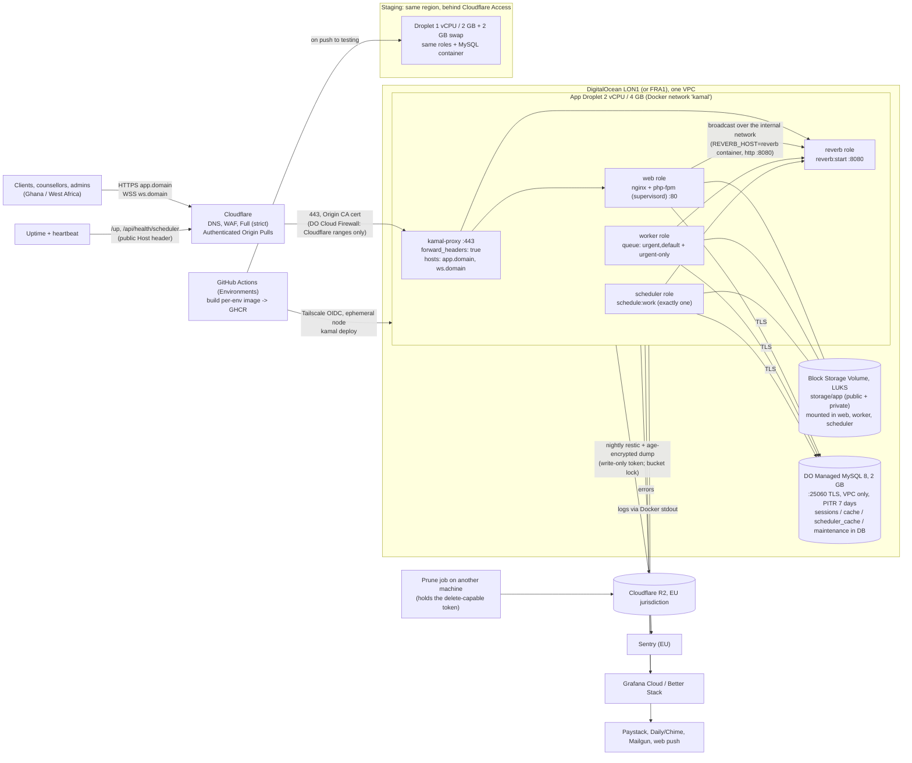

# Deployment options: staging and production (SCRUM-466)

Planning document only. Nothing here changes infrastructure, code or config. Prices were checked on
**2026-11-22** unless a row says otherwise. A price marked **(unverified)** could not be confirmed on the
provider's own page or price API that day, so confirm it before relying on it. Nothing marked
**(legal)** should be treated as settled until a Ghanaian data-protection lawyer has confirmed it.

Revision 2 (same day) adds the devops review's findings:

- the sessions table name clash;
- file stores under Kamal;
- maintenance mode across containers;
- `/up` vs `trustHosts`;
- build-time `VITE_*` values;
- the production image checklist;
- storage volumes;
- Reverb on its own subdomain;
- Cloudflare and origin hardening;
- the full trigger list and database users;
- scheduler and queue fixes;
- secrets and backup hardening;
- recovery targets (RPO and RTO);
- ticket order.

## 1. Executive summary

**Recommendation: one provider for the app and the database, in one European region. Use other
providers only at the edges.**

- **Production:** DigitalOcean **LON1 (London)**, or FRA1 if the Accra latency test (T1) favours it.
  - **Server:** one Droplet (2 vCPU / 4 GB) running the app as Kamal roles:
    - `web`: nginx + php-fpm in one container;
    - `reverb`: on its own `ws.` subdomain;
    - `worker`: both queue workers;
    - `scheduler`: exactly one.
  - **Database:** **DO Managed MySQL 8** (2 GB, single node), with daily backups and 7-day point-in-time
    recovery (PITR) included, encryption at rest, and access only from the private VPC.
  - **Files:** user files (`storage/app`, both the public and the private disks) on an encrypted
    **DO Block Storage Volume**, backed up off-provider with restic.
  - **Cost:** about **US$78/month** at launch, and about **US$239/month** at 10× (section 10).
- **Staging:** the same provider and region at the smallest size. A US$12 Droplet with 2 GB of swap, or the
  US$24 4 GiB plan, with MySQL in a container. Deployed automatically from `testing`, and placed behind
  Cloudflare Access because the demo seed passwords are known.
- **Edges, where mixing providers pays:**
  - **Cloudflare** in front: DNS, Full (strict) TLS with an Origin CA certificate and Authenticated Origin
    Pulls, WAF.
  - **Cloudflare R2** with an EU jurisdiction bucket and bucket locks: encrypted off-provider copies of the
    database dumps and of `storage/app`.
  - **SaaS monitoring** on free tiers: Sentry, Better Stack or UptimeRobot, and Grafana Cloud.
- **Deploys:** images built in GitHub Actions and pushed to GHCR, then **Kamal 2** to the hosts.
  - CI reaches the hosts over **Tailscale with GitHub OIDC** (workload identity federation). No SSH port is
    open to the internet, and no long-lived *cloud* key is stored in CI. This replaces the EC2 workflow's
    `ACCESS_KEY` / `SECRET_ACCESS_KEY` secrets. App secrets are a separate matter (section 7).
  - A maintenance-mode deploy stays available for releases with migrations that aren't backward-compatible
    (section 6.4).
- **Don't:**
  - Put the app and the database at different providers (section 4).
  - Use **PlanetScale (Vitess)**. It doesn't support triggers, and 17 triggers on 9 tables keep the audit
    and safety tables append-only (section 3.2).

**Urgent decision (by 30 Nov 2026): high availability (HA) on DO.**

- From 30 Nov 2026, new DO Standard Edition MySQL clusters can't add standby nodes or plans over 4 GiB.
  Clusters created before that date keep those options.
- **If a standby on Standard Edition might ever be wanted, create the production cluster before 30 Nov.**
  It can start as a single node, but it costs from the day it exists: about US$30/month for 2 GiB.
- Otherwise, HA later means Advanced Edition (smallest shared plan 8 GiB, price not published) or a move to
  RDS Multi-AZ.

**Gating checks before committing:**

1. **Database compatibility spike (T2).** The migrations create 17 triggers, so they need
   `log_bin_trust_function_creators=1` or an equivalent privilege, which DO doesn't document. The spike
   also checks:
   - `sql_require_primary_key`;
   - restoring a dump that contains triggers as a user without SUPER (the DEFINER clauses);
   - `--set-gtid-purged=OFF`;
   - that a PITR fork keeps the triggers.
   If any of these fails, fall back to option C (AWS RDS: the flag is set in a parameter group) or option B
   (MySQL we run ourselves).
2. **Latency from Accra (T1).** No published Accra-to-region measurement was found.
3. **Legal review (T15)** of where data may be hosted (section 8).
4. **Shared stores (T10) before the first Kamal deploy.** With separate, replaceable containers, file
   sessions and caches break (section 2), and the session table name clashes with a domain table.

**Ranked options (details in sections 3 and 10):**

| # | Option | Launch / month | 10× / month | Why / why not |
|---|---|---|---|---|
| **A** | **DigitalOcean LON1/FRA1**: Droplet + Volume + Managed MySQL + R2 | **≈ US$78** | **≈ US$239** (single-node DB) | Cheapest option that includes a managed database with PITR. Simple. No African region. HA: see the urgent decision above. Trigger support not yet verified. |
| B | **Hetzner NBG1/FSN1**: VMs + MySQL we run ourselves + R2 | **≈ €38** + ≈ US$9 | **≈ €186** + ≈ US$46 | Cheapest by far. No managed MySQL, so we own backups, binlog PITR, replicas and patching. |
| C | **AWS eu-west-2 (London)**: EC2 + RDS + R2 | **≈ US$59** + unverified storage/IPv4 | **≈ US$407** + unverified ALB/storage | About the same as A at launch. Native OIDC and SSM (no Tailscale needed), Multi-AZ at small sizes, triggers via a parameter group. Egress makes it the most expensive at 10×. The fallback if the A spike fails. |

## 2. What the stack needs

From `docker-compose.yml`, `docker/`, `scripts/deploy.sh`, `.env.docker.example`, `config/*.php`,
`bootstrap/app.php`, `routes/console.php` and the migrations:

| Concern | Today (Docker dev / EC2) | What production needs |
|---|---|---|
| Web | nginx and php-fpm in **separate** containers (`web`, `php`), sharing a bind-mounted checkout | kamal-proxy forwards HTTP to **one** container. nginx + php-fpm under supervisord on :80 in the same image (or FrankenPHP). TLS terminates at Cloudflare → origin certificate. |
| Frontend | `vite` dev server; `npm run build` on the box during deploy | Assets built in CI. `VITE_*` values are **baked in at build time**: `VITE_REVERB_APP_KEY/HOST/PORT/SCHEME`, `VITE_APP_URL`, `VITE_GOOGLE_API_KEY`, `VITE_APP_NAME`. Staging and production **can't share one image** unless config is injected at runtime (section 7). `VITE_REVERB_PORT` currently reuses the internal `REVERB_PORT` and must be decoupled (public 443 vs internal 8080). |
| Database | MySQL 8.0, `--log-bin-trust-function-creators=1` | MySQL 8 with the flag or an equivalent. **17 triggers on 9 tables** (`cma_*`, `aca_*`, `cve_*`, `ene_*`, `sfe_*`, `sf_no_delete`, `sfn_*`, `pfwe_*`, `cre_*`). TLS to DO (port **25060**, DO's CA certificate via `MYSQL_ATTR_SSL_CA`). REPEATABLE READ assumed (SCRUM-467). |
| Queue | `QUEUE_CONNECTION=database`; `queue:work --queue=urgent,default` + an `urgent`-only worker, `--timeout=60` | Same command lines in the `worker` role. Container stop timeout **≥ 70 s** (longer than the 60 s job timeout). Alert on restart loops: an urgent ring's time-to-live is 120 s. |
| Scheduler | `schedule:work` in the `queue` container | **Exactly one** `scheduler` role container. The old one is stopped before the new one starts. |
| Websockets | Reverb, one process, port 8081, reached via the same host | Its own Kamal role on **`ws.<domain>`** (a DO load balancer can't route by path). The app broadcasts to Reverb over the internal Docker network, not through Cloudflare. `ext-uv` is optional until about 800 connections (stream_select is limited to 1,024 open files). |
| Sessions / cache | `SESSION_DRIVER=file`, `CACHE_DRIVER=file`, scheduler file store (SCRUM-373) | **Not OK under Kamal**, even on one Droplet: every deploy replaces the containers, which have no shared filesystem for `storage/framework`. That would:  • log everyone out; • reset rate limiters (sign-up and urgent-help limits); • lose the scheduler's once-only keys, so reminders are re-sent; • stop `queue:restart` / `reverb:restart` signals (cache keys) reaching the other containers; • make `onOneServer()` useless while two containers overlap. **Database stores are a launch prerequisite (T10).** |
| Sessions table | `config/session.php:88` hard-codes `'table' => 'sessions'`. The domain `sessions` table (therapy sessions, `2024_03_25_082120`) has that name. No cache or cache_locks migrations exist. | T10: an env-driven session table (`SESSION_TABLE=http_sessions`) and its migration; `cache` and `cache_locks` migrations; a **separate table** for the scheduler store (for example `scheduler_cache`), so `cache:clear` on the default store leaves the once-only keys alone. |
| Maintenance mode | `artisan down` writes a file in `storage/framework` | With several containers, the file reaches only one. Use `APP_MAINTENANCE_DRIVER=cache` with `APP_MAINTENANCE_STORE=database` (already in `config/app.php`; needs T10), or proxy-level maintenance (section 6.4). |
| Health check | `health: '/up'` in `bootstrap/app.php`; `trustHosts` (SCRUM-397) applies to `/up` too | kamal-proxy probes the container by its internal address, so the Host header won't be `APP_URL`'s host. The probe will probably fail (rejected host). Fix and verify in T5: an nginx `location = /up` that sets `HTTP_HOST` to the public host before php-fpm, or the internal hostname in `TRUSTED_HOSTS` (the checklist allows bare non-serving names). |
| Redis | Not used (no predis, no phpredis) | Not needed at launch or at 10× with database stores. Only for Reverb horizontal scaling (T11). |
| Files | Local disks: `public`, plus four private disks under `storage/app/private`; no S3 package | A **persistent volume for all of `storage/app`** (public and private), mounted in **both** the web and the worker/scheduler roles, because scheduled jobs delete expired private files. A separate worker Droplet at 10× needs object storage first (T12). |
| Uploads | Identity, licence and age-check documents allow 10 MB (`max:10240`) | nginx `client_max_body_size`, and PHP `upload_max_filesize` / `post_max_size`, at least **12M**. |
| Mail / external | Mailgun (EU endpoint commented); Paystack webhook `POST /api/paystack/webhook`; Daily or Chime; web push | Outbound HTTPS. WAF skip rule for the webhook (section 7). |
| Deploy | GitHub Actions → AWS SSM → `scripts/deploy.sh` on one EC2 box (`eu-north-1`); long-lived IAM keys | Section 6. |

**Current state:**

- The decision log (SCRUM-292 entry) records "there is no production deployment or data yet".
- SCRUM-412 isn't referenced in the repo, so readiness context comes from SCRUM-411/413.
- `testing` → `main` stays gated on SCRUM-364 and the production items those entries list.

## 3. Candidates and prices

Monthly figures are the hourly rate × 730 h where only an hourly rate is published. All prices are in the
provider's own currency and exclude VAT/tax. Accessed 2026-11-22.

### 3.1 Compute (one 2 vCPU / 4 GB node, the launch size)

| Provider / region | Plan | vCPU / RAM | Monthly | Egress included / overage | Source |
|---|---|---|---|---|---|
| **Hetzner** NBG1 (Nuremberg) | CPX22 | 2 / 4 GB, 80 GB NVMe | **€19.99** (NBG1 only; €16.99 in HEL1) | 20 TB included; €1/TB over | hetzner.com/cloud/regular-performance |
| Hetzner NBG1/FSN1 | CPX12 / CPX32 | 1 / 2 GB; 4 / 8 GB | €11.99 / €35.99 | 20 TB | same |
| Hetzner | Backups | 7 slots | 20% of the server price (**inferred**: "from €1.098" = 20% of €5.49) | — | same |
| **DigitalOcean** LON1/FRA1/AMS3 | Basic 4 GiB | 2 / 4 GiB, 80 GiB | **$24.00** | 4,000 GiB pool; overage rate not shown **(unverified)** | digitalocean.com/pricing/droplets |
| DigitalOcean | Basic 2 GiB / 8 GiB | 1/2 GiB; 4/8 GiB | $12.00 / $48.00 | 2,000 / 5,000 GiB | same |
| DigitalOcean | Backups | weekly / daily | 20% / 30% of the Droplet price. Attached Volumes not covered: assume restic is their only backup (DO's Volume page doesn't say) | — | same |
| DigitalOcean | Block Storage Volume | — | **$10/month for 100 GiB** ($0.10/GiB; 100 GiB is the smallest tier listed); snapshots $0.06/GiB. "All DigitalOcean Volumes are encrypted with LUKS" (re-check at provisioning) | — | digitalocean.com/pricing/volumes; DO Volumes features doc |
| **Akamai (Linode)** | Linode 4 GB | 2 / 4 GB | $24.00 | 4 TB; $0.005/GB over | akamai.com/cloud/pricing/cpu |
| **AWS** eu-west-2 London | t4g.medium | 2 / 4 GiB | **$27.45** + EBS + public IPv4 **(unverified)** | 100 GB/month free; then $0.09/GB | AWS price API; S3 pricing page |
| AWS eu-west-1 / eu-central-1 / eu-north-1 (today) / af-south-1 | t4g.medium | 2 / 4 GiB | $26.86 / $28.03 / $25.11 / $31.68 | $0.09/GB (EU), **$0.154/GB** (Cape Town) | AWS price API |
| **GCP** europe-west1 / europe-west2 / africa-south1 | e2-medium | 2 shared / 4 GB | $26.91 / $31.51 / $26.91 (third-party, **unverified**) | not checked | gcloud-compute.com |
| **Azure** West Europe / UK South / South Africa North | B2als_v2 | 2 / 4 GiB | $31.54 / $31.03 / $35.62 | not checked | Azure Retail Prices API |
| **OVHcloud** | VPS-1 | 2 / 4 GB | "from" $4.54 (likely with a commitment; locations not shown) **(unverified)** | unlimited, 500 Mbps | ovhcloud.com/en/vps |
| **Fly.io** | shared-cpu-2x 2 GB | 2 shared / 2 GB | $13.39 (iad) | Europe $0.02/GB; Africa $0.12/GB | docs.fly.io/about/pricing |
| **Render** | 2c-4g | 2 / 4 GB | $85 + workspace (Pro $25) | 25 GB; $0.15/GB over | render.com/pricing.md |
| **Railway** | usage | — | ≈ $20/vCPU + $10/GB RAM per month (2/4 ≈ $80) + plan | $0.05/GB | railway.com/pricing |

Notes:

- **Staging that can "sleep".**
  - Hetzner, DO and Linode bill powered-off VMs in full.
  - AWS and GCP stop charging compute when stopped (a t4g.small at about 260 h/month is **$4.89**).
  - Fly bills only the root filesystem while a Machine is stopped.
- **PaaS fit.** Render and Fly have no managed MySQL (Postgres only). Railway's MySQL is a template
  container we would run ourselves. With five process types, the PaaS options cost 3–4× a VM.
  Laravel Cloud wasn't priced.

### 3.2 Managed MySQL

| Service / region | Smallest useful plan | Monthly | Backups / PITR | Triggers | Source |
|---|---|---|---|---|---|
| **DO Managed MySQL** (LON1/FRA1/AMS3) | 1 GiB / 1 vCPU, 10–30 GiB | **$15.15** | Daily backups free; **PITR 7 days** (a restore creates a *new* cluster with a new hostname) | **Not documented.** System variables can't be edited; config requests go through the API. **T2.** | DO pricing; DO limits doc |
| DO Managed MySQL | 2 GiB / 1 vCPU, 30–60 GiB | **$30.45** | same | same | same |
| DO Managed MySQL | 4 GiB / 2 vCPU, 60–120 GiB | $60.90 | same | same | same |
| DO: HA | Standard Edition standby costs the same as the primary, but **from 30 Nov 2026 new Standard clusters can't add standbys or plans over 4 GiB**. Advanced Edition's smallest shared plan is 8 GiB (price shown at creation) **(unverified)**. Existing clusters keep their options. | — | — | — | DO pricing doc; DO release note (plan changes from 15 Oct 2026) |
| DO: maintenance | A **single-node cluster is unavailable during DO's maintenance window**. Set the window to a quiet Ghana hour (for example, 03:00–04:00 GMT, outside the scheduler's 01:00–05:15 jobs if possible). | — | — | — | DO managed database behaviour **(unverified for exact downtime)** |
| **AWS RDS MySQL** London | db.t4g.micro / db.t4g.small Single-AZ | $13.14 / **$26.28** + storage **(unverified)** | Automated backups + PITR | **Yes**, via a parameter group | AWS price API |
| RDS London | db.t4g.small / db.t4g.medium Multi-AZ | $52.56 / **$105.85** | same | same | same |
| RDS af-south-1 / eu-north-1 | db.t4g.small Single-AZ | $29.93 / $24.09 | same | same | same |
| **Aiven for MySQL** | Hobbyist / Startup 4 GB / Business (HA) | $19 / **$75** / $180 ("from") | Hobbyist: a single backup only. Startup: PITR 2 days. Business: 14 days | **(unverified)** | aiven.io/pricing/mysql |
| **Akamai Managed MySQL** | Shared 1 GB | $16 (1 node) / $37 (3 nodes) | **(unverified)** | **(unverified)** | akamai.com/cloud/pricing/databases |
| **GCP Cloud SQL** | db-g1-small (no SLA) | ≈ $26 europe-west1 (third-party, **unverified**) | Backups + PITR | Database flag (**unverified**) | bytebase.com/dbcost |
| **Azure MySQL Flexible** West Europe | B1ms / B2s | $14.53 / $58.11 + storage $0.1369/GB | Backup storage $0.103/GB | Defaults to ON | Azure Retail Prices API |
| **PlanetScale (Vitess)** | PS-10, 3-node only | $39 | Billed separately | **No** ("any form of stored routines" unsupported) | planetscale.com/pricing; compatibility doc |
| Hetzner | No managed MySQL found | — | — | — | hetzner.com/cloud |

**The 17 triggers**, on 9 tables, from the migrations:

| Prefix | Triggers |
|---|---|
| `cma` (confidential-message access log) | `cma_no_update`, `cma_no_delete` |
| `aca` | `aca_no_update`, `aca_no_delete` |
| `cve` | `cve_no_update`, `cve_no_delete` |
| `ene` | `ene_no_update`, `ene_no_delete` |
| `sfe` | `sfe_no_update`, `sfe_no_delete` |
| `sf` | `sf_no_delete` |
| `sfn` (safety-flag notes) | `sfn_no_delete`, `sfn_only_clear` |
| `pfwe` (commission-free period history, SCRUM-475) | `pfwe_no_update`, `pfwe_no_delete` |
| `cre` (recognition history, SCRUM-475) | `cre_no_update`, `cre_no_delete` |

Vitess runs none of them, so **PlanetScale is ruled out**.

The README's trigger-recovery list now names all of them (SCRUM-475 added `sfe_*` and `sf_no_delete`, which it
had missed, along with the two new prefixes).

**Database users (T17):**

- **Migrator user:** DDL + `TRIGGER` (+ `CREATE ROUTINE` not needed), used only by the pre-deploy migrate
  hook.
- **Runtime user:** DML only (`SELECT, INSERT, UPDATE, DELETE`), used by web, worker, scheduler and
  Reverb.

A runtime compromise then can't drop the append-only triggers. DO lets you create extra users and set
their grants with SQL; confirm in T2.

### 3.3 Object storage (backups, and later the private disks)

| Service | Storage | Egress | Requests | Free tier | Residency / locks | Source |
|---|---|---|---|---|---|---|
| **Cloudflare R2** | $0.015/GB-month | **Free** | A $4.50/M, B $0.36/M | 10 GB-month, 1M A, 10M B | **EU jurisdiction**; bucket locks (retention rules) **(feature not re-checked)** | developers.cloudflare.com/r2/pricing, …/data-location |
| **Backblaze B2** | $6.95/TB-month | Free up to 3× stored, then $0.01/GB | A–C free | 10 GB | — | backblaze.com/cloud-storage/pricing |
| **AWS S3 Standard** | $0.023 (Ireland) / $0.0245 (Frankfurt) / $0.0274 (Cape Town) per GB | $0.09 / $0.154 per GB after 100 GB | GET $0.0004/1k | — | Object Lock | AWS price API |
| Hetzner Object Storage | €6.49/month incl. 1 TB stored + 1 TB egress | €1/TB over | — | — | FSN1/NBG1/HEL1; object lock | hetzner.com/storage/object-storage |
| DO Spaces | "from $5/month" **(unverified amounts)** | — | — | — | LON1/FRA1/AMS3 | digitalocean.com/pricing |

### 3.4 Region and latency to Ghana / West Africa

- **No hyperscaler region in West Africa.** The closest are AWS af-south-1, GCP africa-south1 and Azure
  South Africa North. DO and Hetzner have none in Africa.
- **Routing may favour Europe.** Cloudflare's 2018 RIPE Atlas study found that Ghana traffic mostly
  exchanged in Europe. Region-to-region, Cape Town ↔ Frankfurt/Ireland is about 155–160 ms (third-party).
  No Accra figure was found, so **all latency claims are unverified**.
- **T1** measures from Accra (fixed and mobile) to LON1, FRA1, AMS3, NBG1/FSN1, eu-west-2, af-south-1 and
  africa-south1.
- Video is unaffected: Daily and Chime media go to their own edges.

## 4. Mixing providers

| Dimension | App and DB at **different** providers | Edges at different providers |
|---|---|---|
| **Latency** | A few milliseconds per round trip even in one metro **(unverified)**. 30–60 sequential queries turn 3 ms into 90–180 ms per request. | Not on the request path. |
| **Egress** | Every query result crosses the internet; two bills to watch. | R2 egress free; B2 free up to 3×. |
| **Private networking / TLS** | No shared VPC: TLS + IP allowlists, or WireGuard/Tailscale on the critical path. | HTTPS APIs. |
| **Backups / PITR** | Managed PITR still works; restores cross providers. | Off-provider backups are the main benefit (survive an account compromise or billing lock). |
| **Failure domains** | Worse: availabilities multiply (99.9% × 99.9% ≈ 99.8%), plus the link. | Better for backups. Cloudflare becomes a serving dependency (acceptable). |
| **Operational burden** | Two consoles, bills and credential sets; split triage. Heavy for one person. | Low. |
| **Verdict** | **Don't**, unless both share a metro and a measured round trip is under ~1 ms. | **Do**: Cloudflare, R2, monitoring SaaS. |

Other mixes considered:

- **Staging on Hetzner while production is on DO:** staging stops mirroring production, for a saving of
  ≈ $0–3. Not worth it.
- **Hetzner compute with Aiven on DO:** cancelled out by Aiven's $75 plus the cross-provider latency. Not
  worth it.

## 5. Recommended setup

**At 10×**, the same design with these changes:

1. **Do T12 first:** files to R2 with signed streaming. Nothing then needs a shared volume across Droplets.
2. **Web:** two web Droplets (4 vCPU / 8 GB) behind a **DO load balancer** routing `app.` by host.
   - `ws.` points to a single Reverb role, on one of them or on its own small Droplet.
   - Set the LB idle timeout above the WebSocket ping interval.
3. **Worker:** one worker Droplet with the queue workers and the single scheduler.
4. **Database:** MySQL grows to 4 GB. HA per the section 1 decision.
5. **Reverb:** one process is enough. Redis scaling (T11) only beyond one process.

## 6. Deployment approach

### 6.1 Tooling

| Approach | Fit | Notes |
|---|---|---|
| **Docker Compose on a VM** | One node only | Today's compose file is dev-only. No gapless switching. |
| **Kamal 2** (docs 2.12.0) | **Recommended** | kamal-proxy gapless deploys with health checks; Let's Encrypt or custom certificates (Cloudflare Origin CA); multi-host roles; `kamal rollback`; free. Needs `forward_headers: true` behind Cloudflare (the docs say `ssl: true` stops header forwarding otherwise). WebSocket hold time and `response_timeout` to test in T5. |
| **Coolify** | OK | Self-hosted free; Cloud $5/month + $3 per extra server. Another internet-facing control plane holding the secrets. |
| **Nomad / k3s** | Overkill | Revisit at more than about 6 nodes. |
| **PaaS** | Poor | No managed MySQL (Render, Fly); 3–4× the cost. |

### 6.2 The production image (T4)

The current `docker/` images are dev images. T4 must:

- **Database wait:** replace the entrypoint loops `until nc -z db 3306` (`docker/php/entrypoint.sh`,
  `docker/reverb/entrypoint.sh`). The host and port are hard-coded, and DO uses its own host on port
  **25060**. Wait on `DB_HOST:DB_PORT` from the env, with a timeout, or drop the wait and rely on restarts.
- **Entrypoint:**
  - **Remove** the `key:generate` on an empty `APP_KEY`: a missing key must fail loudly.
  - **Remove** migrate-on-boot and seed-on-boot. Migrations run once from the deploy hook (6.4).
- **Web container:** nginx + php-fpm in **one** container under supervisord, listening on :80 for
  kamal-proxy (or FrankenPHP). Port `docker/nginx/default.conf`, including `/sw.js` no-cache and the
  manifest type.
- **Build:**
  - **COPY** the code instead of bind-mounting it.
  - `composer install --no-dev --optimize-autoloader`.
  - **Pin the composer image** by version or digest.
  - Built assets from a node stage.
- **PHP:**
  - Enable **opcache** (`validate_timestamps=0`).
  - Tune php-fpm `pm.max_children` to the RAM (for example ~10–15 on a 4 GB node shared with the other
    roles; measure).
  - `memory_limit` ≥ 384M (journal PDF export, per the checklist).
  - `request_terminate_timeout` / `fastcgi_read_timeout` ≥ 90 s.
- **Uploads:** nginx `client_max_body_size 12m`; PHP `upload_max_filesize=12M`, `post_max_size=12M`
  (uploads allow 10 MB).
- **Logs:** to **stdout/stderr** (`LOG_CHANNEL=stderr`, or a stack including stderr), with Docker log
  rotation (`max-size`/`max-file`) in the Kamal `logging` config. `storage/logs` is not on the volume.
- **At container start:** `php artisan optimize` (config, routes, events, views).
  - The checklist says event caching must then run on every deploy, and it does, because every container
    start does it.
  - Route names are unique since SCRUM-426, so route caching works.
- **TLS to the database:** ship **DO's CA certificate** (as a secret file) and set
  `MYSQL_ATTR_SSL_CA` (`config/database.php` already reads it).
- **Extensions:** curl, openssl, mbstring, dom, gd, iconv, intl as needed (checklist). `ext-uv` optional
  until about 800 concurrent connections.
- **Runtime user:** run as `www-data`. Volume ownership is set once (the private-disk modes from
  `deploy.sh`: `ug+rwX,o-rwx`, setgid).

### 6.3 Roles, nodes and Reverb

- **Roles on one Droplet at launch:**
  - `web` (proxied on `app.`);
  - `reverb` (proxied on `ws.`, its own role and host name);
  - `worker` (not proxied);
  - `scheduler` (not proxied, one container).
- **Volume:** `/mnt/storage/app` is mounted into `web`, `worker` and `scheduler`. The scheduler and the
  queue delete expired identity and licence documents, so the worker roles need the files too.
- **Broadcasting:** the app broadcasts to Reverb on the internal Docker network (`REVERB_HOST=<reverb
  container/alias>`, `REVERB_PORT=8080`, `REVERB_SCHEME=http`). Browsers connect to
  `wss://ws.<domain>:443` (`VITE_REVERB_HOST/PORT/SCHEME`, decoupled, section 7). Broadcast traffic never
  leaves the host or passes through Cloudflare.
- **Timeouts:**
  - The app's Reverb `ping_interval` is 60 s (`config/reverb.php`). That is under Cloudflare's WebSocket
    idle limit, which is commonly given as 100 s. Cloudflare's connection-limits page lists a 125 s proxy
    read timeout and a 900 s idle timeout; WebSocket-specific idle behaviour is **unverified**.
  - In T5, hold a socket open for more than 10 minutes through kamal-proxy and check its
    `response_timeout`.
  - At 10×, set the DO LB idle timeout above the ping interval.
- **Deploys drop sockets.** Every Reverb restart drops every socket, and nothing replays missed events.
  - The UI must **resync on reconnect**: refetch chat, notifications and urgent-help state on Echo's
    reconnect (a follow-up if not already done).
  - **Leave the Reverb role out of routine deploys** (`kamal deploy --roles=web,worker,scheduler`). Deploy it
    only when broadcasting code or Reverb config changes.
- **Reverb health check:** confirm it in T5. kamal-proxy needs an HTTP path that answers 200 on the Reverb
  container (Reverb serves `/up`? **unverified**). Otherwise, a TCP check, or a small health route added
  to the Reverb server.
- **Adding nodes (10×):** T12 first, then the LB, then `TRUSTED_PROXIES` updated to include the LB and the
  Docker network. Reverb scaling (`REVERB_SCALING_ENABLED` + Redis, T11) only beyond one process.

### 6.4 Scheduler, migrations, maintenance and rollback

- **Scheduler exactly once:**
  - A dedicated `scheduler` role with one container. Kamal stops the old container before starting the new
    one for non-proxied roles (confirm in T5). Set its stop timeout so a running minute finishes.
  - T10 also adds `->onOneServer()` (with the shared database cache) to every every-minute task that lacks
    it: `notify-starting-sessions`, `broadcast-started-sessions-and-discussions`,
    `notify-starting-discussions`, both `guardian-video-consent-*` reminders, `sweep-help-requests`,
    `scheduler-heartbeat` and `expire-idle-speaking-grants`. An accidental overlap then can't double-send.
  - Add `schedule:interrupt` to the post-deploy hook.
- **Workers:** stop timeout **≥ 70 s** (job `--timeout=60`). Alert on restart loops: if the urgent worker
  flaps for more than 2 minutes, rings expire unsent.
- **Migrations (forward-only):** a Kamal **pre-deploy hook** runs `php artisan migrate --force` once, in a
  one-off container from the **new** image, as the **migrator** database user.
- **Two deploy modes:**
  1. **Standard (zero downtime)**, for backward-compatible (expand/contract) migrations:
     - pre-deploy migrate;
     - `kamal deploy --roles=web,worker,scheduler`;
     - kamal-proxy switches traffic once `/up` answers;
     - post-deploy: `queue:restart` and `schedule:interrupt`. These work only once the cache is shared
       (T10).
  2. **Maintenance**, for breaking or slow data migrations (for example SCRUM-437, SCRUM-467). **Use the
     cache maintenance driver:** `APP_MAINTENANCE_DRIVER=cache`, `APP_MAINTENANCE_STORE=database` (keys
     already in `config/app.php`; needs T10).
     - `artisan down --retry=60` from a one-off container sets the flag in the database, so **every** web
       container returns 503.
     - Stop the `worker` and `scheduler` roles (`kamal app stop --roles=worker,scheduler`) so nothing
       writes during the migration. Scheduled tasks skip maintenance mode anyway, but queued jobs don't.
     - Migrate, deploy, `artisan up`, start the roles.
     - Alternative if T10 isn't done: kamal-proxy's maintenance mode (`kamal proxy` maintenance, **verify
       the command in T5**), with the worker and scheduler stopped the same way. The cache driver is
       preferred, because it is visible to the app and keeps `/up` and the Paystack webhook behaviour
       predictable.
- **The production checklist still governs each release:** roll back code, not migrations, and never
  rotate `APP_KEY` in the same deploy.
- **Port `deploy.sh`'s guards:**
  - the commit must be on `origin/main`;
  - one deploy at a time (`concurrency: production-deploy`);
  - ownership of the volume's private directories;
  - the leftover-public-files warning.
- **Rollback:** `kamal rollback <version>` (the previous image tag, which is the commit SHA) switches the
  containers back. Migrations stay forward-only: a rollback works only where the previous code tolerates
  the new schema, which the expand/contract rule ensures. For a maintenance release, follow that ticket's
  rollback notes in the checklist.

## 7. Environments, edge and secrets

| | Local | Staging | Production |
|---|---|---|---|
| Branch | feature/* | **`testing`** (new: deploys on push) | **`main`** |
| Size | Docker Compose | 1 vCPU / 2 GB + 2 GB swap ($12), or $24 / 4 GiB | Section 5 |
| `APP_ENV` | `local` | `staging` (never `local`/`testing`) | `production` |
| Access | — | **Behind Cloudflare Access** (the demo seed passwords are public in `documentation/seeded-data.md`) | public |
| Data | seeders | Seeded demo data only. Never production data | real |
| Third parties | test keys, Mailpit | Paystack test keys, a Daily test domain, a Mailgun sandbox or subdomain, its own Google OAuth redirect URI and VAPID keys | live |
| `APP_KEY` | dev | its own | its own, backed up **apart from** the database |
| Image | — | built with staging's `VITE_*` | built with production's `VITE_*` |

**Build-time `VITE_*` values.** Choose **per-environment builds** (recommended now, T4/T6): the build job
runs once per GitHub Environment with that environment's `VITE_*` variables and tags the image
`<sha>-staging` / `<sha>-production`.

- `VITE_REVERB_PORT=443` and `VITE_REVERB_SCHEME=https` are set independently of the server's internal
  `REVERB_PORT=8080`.
- The alternative is to inject runtime config from Blade (`window.__CONFIG__` read by `bootstrap.js`). One
  image could then be promoted from staging to production, but that is a code change across the Echo and
  Google setup, so it is a later improvement.

**Promotion:** `develop` → `testing` → `main` through PRs (CLAUDE.md). A merge into `testing` deploys
staging; a merge into `main` deploys production.

**Edge and origin hardening (T16):**

- **TLS:** Cloudflare **Full (strict)** with a **Cloudflare Origin CA** certificate in kamal-proxy, plus
  **Authenticated Origin Pulls** (mTLS from Cloudflare to the origin).
- **Firewall:** **DO Cloud Firewalls**, not ufw, because Docker's published ports bypass ufw. Inbound 443
  from Cloudflare's ranges only, and nothing else (SSH only over the tailnet).
- **`TRUSTED_PROXIES`:** Cloudflare's published ranges **plus the kamal-proxy Docker network CIDR** (the
  web container sees kamal-proxy as the peer). kamal-proxy needs `forward_headers: true`.
  - Without both, every visitor shares one address: one sign-up limit and one urgent-help limit for
    everyone (production checklist, SCRUM-395/400/138).
  - The checklist's /8 and /29 limits apply. Docker's default bridge networks are /16 or /20, so they are
    accepted.
- **WAF skip rules:** `POST /api/paystack/webhook` (Paystack's servers; the app checks the signature), the
  uptime probe user agents or IPs, and the WebSocket upgrade on `ws.`.
- **Cloudflare plan:** Free covers DNS, proxy, the Free Managed Ruleset and Access for small teams. **Pro
  ($20/month annual, $25 monthly)** if the fuller managed or OWASP rulesets are wanted. The Free/Pro ruleset
  names weren't confirmed on the plans page **(unverified)**.

**Secrets:**

- **Reaching the hosts:** the Tailscale GitHub Action with workload identity federation
  (`id-token: write`, no auth key, ephemeral tagged node, ACL limited to SSH on the deploy hosts).
  - Tailscale's free Personal plan is **non-commercial only**, so budget **Standard at $8/user/month**.
  - Check that workload identity federation is included on the chosen plan (the pricing page doesn't say;
    the docs announce it as generally available on all plans).
- **Registry:** GHCR. `packages: write` on the build job; **`packages: read` on the deploy job**, whose
  short-lived `GITHUB_TOKEN` is used as the registry password.
- **Cloud APIs:** OpenTofu runs from a maintainer's machine, so CI holds no DO token. (AWS: OIDC
  `role-to-assume`.)
- **App secrets:** `APP_KEY`, the database passwords, Paystack, Daily/Chime, Mailgun, VAPID, Google OAuth,
  the Reverb secret, DO's CA certificate.
  - **Plainly: these still need a long-lived credential somewhere.** If Kamal reads them from a password
    manager, CI needs that manager's long-lived service-account token.
  - Recommended: store them as **GitHub Environment secrets** (`staging`, `production`), with
    **deployment branch rules** so only `testing` can use `staging` and only `main` can use `production`.
    Add a required reviewer on `production` once a second person joins.
  - The deploy job writes `.kamal/secrets` from those values at run time.
  - Keep an offline copy of `APP_KEY`, `APP_PREVIOUS_KEYS` and the VAPID keys in a password manager with
    emergency access.
- **Per-environment config:** `config/deploy.yml` + `config/deploy.staging.yml` (`env.clear` for
  non-secrets, `env.secret` for secrets). Differences are reviewable in git without values.
  `.env.docker` stays local-only.
- **Branch guard in the workflow:** the deploy job also checks `github.ref` against the environment
  (`testing` → staging, `main` → production) and that the SHA is on that branch, as `deploy.sh` does for
  `main` today.

## 8. Data and compliance

**Legal confirmation is needed for every item marked (legal).**

- **Who:** TalkTherapy GH (Ghana) is the controller under Act 843, per `resources/js/Pages/Privacy.vue`
  (SCRUM-364).
- **Special personal data:** health and mental condition are special personal data (DLA Piper, 18 Mar
  2026). The platform also holds identity documents and minors' data (see also the Children's Act 560).
- **Cross-border (legal):**
  - DLA Piper says Act 843 has no specific transfer provisions; a Templars guide reads it as consent plus
    safeguards.
  - Section 18 requires data about foreign data subjects to be processed under their own law (for example
    Nigeria's NDPA 2023).
  - The draft Data Protection Bill, 2025 adds a cross-border section; its status is unknown.
  - Every option stores data outside Ghana.
  - **Questions for counsel:**
    1. Is UK/EU or South African hosting permitted?
    2. Is consent needed or enough?
    3. What processor terms are required?
    4. Does the country matter?
    5. What changes under the Bill?
- **DPC registration (legal):** required; valid two years, renewed under section 50 three months ahead;
  fees not published. Enforcement is active (GNA, Oct 2026). Confirm it before go-live.
- **Breach notification:** to the Commission and the data subject "as soon as reasonably practicable".
- **Encryption at rest:**
  - DO Managed MySQL is encrypted at rest. **DO Volumes use LUKS** (DO docs), which covers the private files
    on the Volume; re-check at provisioning.
  - `APP_KEY` already encrypts notes, journals, check-ins, 2FA secrets and push subscriptions.
  - Backups are encrypted client-side (restic; `age` for dumps).
  - T13 is now a verification task plus a decision on application-level encryption when files move to R2
    (T12).
- **Backups, retention and recovery targets:**

  | Data | Mechanism | RPO | RTO (target) |
  |---|---|---|---|
  | Database | DO daily backup + **7-day PITR** | minutes (PITR) | ~1 h (fork, then redeploy with the new `DB_HOST`) |
  | Database, off-provider | nightly `mysqldump --single-transaction --triggers --set-gtid-purged=OFF`, `age`-encrypted, to R2 | 24 h | ~2–4 h (new cluster + restore) |
  | `storage/app` (public **and** private disks) on the Volume | nightly restic to R2 (Droplet backups don't cover Volumes) | 24 h | ~1–2 h |
  | Droplet / config | Droplet weekly backup + infrastructure as code + images in GHCR | — | ~1 h (rebuild) |
  | Secrets | password-manager vault, offline | — | — |

  - **Retention:** 7 daily + 4 weekly (≈ 35 days), then expire.
  - **Protection against deletion:**
    - an R2 **bucket lock** (retention rule) sized to the retention;
    - the host's R2 token can **write but not delete**;
    - pruning runs from **another machine** with the delete-capable token.
    A compromised host can't wipe its own backups.
  - **Retention vs the privacy page (legal):** deleted data survives in backups until they expire. The page
    must say "backups are kept up to N days", with N matching.
  - **Restore drill (quarterly, scratch environment, never staging's database)** must check:
    - all 17 triggers exist (`SHOW TRIGGERS`);
    - `APP_KEY`-encrypted data decrypts (a journal entry, a note, a 2FA secret);
    - restored files are readable by `www-data` and stream through the app.
  - **PITR fork drill:** fork to a time, then point the app at the fork's **new hostname** (redeploy with a
    new `DB_HOST` secret). Time it to measure the RTO.
- **Privacy page alignment (SCRUM-364):** name the host and region, Cloudflare, the error, log and uptime
  vendors, and the transfer and safeguards wording (legal). The email provider is named generically.
  Fold this into the open lawyer review.
- **Processor contracts:** accept or sign the DPAs of DO, Cloudflare, Sentry, Better Stack or Grafana,
  Mailgun and Tailscale. Use EU data regions where offered.
- **Logs:** ids and keyed hashes only (`monitoring.md`), no request bodies, Sentry PII scrubbing on and
  `send_default_pii` off.

## 9. Monitoring, logs, alerts and uptime

| Need | Launch choice (free) | Free-tier limits (2026-11-22) | Paid step |
|---|---|---|---|
| Errors | **Sentry Developer** (EU); add `sentry/sentry-laravel` to composer (T9) | 1 user, 5k errors, 5M spans, 30 days, 1 uptime + 1 cron monitor | Team $29/month ($26 annual) |
| Uptime + heartbeat | **Better Stack free** (10 monitors and heartbeats, email/Slack) or **UptimeRobot free** (50 monitors, 5 min, commercial use allowed) | — | +50 monitors $25/month; UptimeRobot Solo $9–10 |
| Logs | **Grafana Cloud free** (50 GB, 14 days) via Alloy reading Docker stdout | — | Pro from $19/month + usage |
| Host metrics | DO monitoring or Alloy | — | — |

**Alerts:**

- **Probes:** `/up` and `/api/health/scheduler` (public Host header; 503 when the urgent sweep is overdue).
- **Scheduler heartbeat.**
- **Queue:**
  - the oldest `urgent` job older than about 60 s;
  - any `failed_jobs` row for `SendHelpPushJob`;
  - **worker container restart loops** (more than 3 restarts in 5 minutes).
- **Log lines:** the "Lines to alert on" in `monitoring.md`.
- **Database:** CPU, connections, storage at 80%, and **maintenance-window events**.
- **Backups:** a backup heartbeat after each restic run and dump.
- **Volume:** usage at 80%.
- **Alert transport:** email + Slack free. Phone or SMS paging is paid (the open SCRUM-413 item).

**Cost:** $0 at launch; about $29–60/month at 10×.

## 10. Cost model

### 10.1 Assumptions

These are planning assumptions, not measurements.

| Item | Staging | Production, launch | Production, 10× |
|---|---|---|---|
| App vCPU / RAM | 1 vCPU / 2 GB + 2 GB swap (all roles + MySQL container) | 2 vCPU / 4 GB, one node, roles web/reverb/worker/scheduler | 2 web × 4 vCPU / 8 GB + 1 worker 2 vCPU / 4 GB |
| Database | container | managed 2 GB, ≤ 30 GB | managed 4 GB, ≤ 60 GB |
| Sessions / cache / maintenance stores | database | **database (T10)** | database (Redis optional) |
| DB data size | < 1 GB | 5–20 GB | 50–60 GB |
| User files (`storage/app`) | < 1 GB | ≤ 20 GB on a 100 GiB Volume | 200 GB on R2 (T12) |
| Backups in R2 (35-day retention) | < 10 GB | ≈ 75 GB (11 compressed dumps of 1–5 GB + restic of files) | ≈ 400 GB (dumps ≈ 15 GB × 11 + restic of 200 GB) |
| Egress to the internet | < 20 GB | 150 GB | 1.5 TB |
| Concurrent WebSockets | < 20 | 200 | 2,000 (one Reverb process; `ext-uv` above ~800) |
| Load balancer | none | none | 1 |

Video media doesn't pass through our servers.

### 10.2 Monthly estimates, top three options

**A. DigitalOcean LON1 (recommended)**, USD:

| Line | Staging | Launch | 10× |
|---|---|---|---|
| Droplets | $12 (+ swap) or $24 | $24 | $96 (2 × 8 GiB) + $24 (worker) |
| Droplet backups (weekly, 20%) | — | $4.80 | — |
| Block Storage Volume (100 GiB min.) | — | $10 | — (files on R2 after T12) |
| Managed MySQL | (container) | $30.45 (2 GiB) | $60.90 (4 GiB, single node); HA per section 1 **(unverified price)** |
| Load balancer | — | — | $12 ("from") |
| Valkey (optional) | — | — | "from $15" **(unverified)** |
| R2 (files + backups) | $0 | ≈ $0.98 (75 GB) | ≈ $8.85 (≈ 600 GB: 200 files + 400 backups) |
| Tailscale Standard (1 user, shared across environments) | (shared) | $8 | $8 |
| Cloudflare | Free (Access **(unverified free seats)**) | Free (Pro +$20–25 optional) | Free (Pro +$20–25 optional) |
| Monitoring | $0 | $0 | $29 |
| **Total** | **$12–24** | **≈ $78.23** (+$20–25 with Cloudflare Pro) | **≈ $238.75** (+$15 Valkey, + Cloudflare Pro, + the HA premium) |

**B. Hetzner NBG1/FSN1, MySQL we run ourselves**, EUR excl. VAT (others in USD):

| Line | Staging | Launch | 10× |
|---|---|---|---|
| App VMs | €11.99 (CPX12) | €19.99 (CPX22) | €71.98 (2 × CPX32) + €19.99 (CPX22 worker) |
| DB VMs | (container) | €11.99 (CPX12) | €71.98 (primary + replica) |
| Backups (20%) | — | €6.40 | €14.40 |
| Load balancer | — | — | €7.49 (LB11) |
| R2, Tailscale, Sentry | $0 | ≈ $1 + $8 | ≈ $9 + $8 + $29 |
| **Total** | **€11.99** | **≈ €38.38 + ≈ $9** | **≈ €185.84 + ≈ $46** |

Hidden cost: binlog PITR, replica failover, MySQL patching and backup verification are ours.

**C. AWS eu-west-2 London**, USD:

| Line | Staging | Launch | 10× |
|---|---|---|---|
| EC2 | $13.72, or $4.89 when stopped outside working hours | $27.45 | $109.79 + $27.45 |
| RDS | (container) | $26.28 (Single-AZ) | $105.85 (Multi-AZ) |
| EBS (files + root), RDS storage, IPv4, ALB, ElastiCache | **(unverified)** | **(unverified)** | **(unverified)** |
| R2 | $0 | ≈ $1 | ≈ $8.85 |
| Egress | $0 | $4.50 | $126.00 |
| Access to hosts | SSM (no Tailscale needed) | SSM | SSM |
| Monitoring | $0 | $0 | $29 |
| **Total (verified lines)** | **$4.89–13.72** | **≈ $59.23** + unverified | **≈ $406.94** + unverified |

- **af-south-1 (Cape Town) variant:** launch ≈ $70, 10× ≈ $531, before the unverified lines.
- **t4g "unlimited" credits:** sustained load can add charges.

### 10.3 Summary

| Monthly | A: DigitalOcean | B: Hetzner | C: AWS London |
|---|---|---|---|
| Staging | $12–24 | €12 | $5–14 + unverified |
| Production, launch | **≈ $78** | ≈ €38 + $9 | ≈ $59 + unverified |
| Production, 10× | **≈ $239** (no HA) | ≈ €186 + $46 | ≈ $407 + unverified (with Multi-AZ) |

## 11. Migration path from the current EC2 deploy

Today: GitHub Actions → SSM → `scripts/deploy.sh` on `i-0ceef8e041cbec9af` (`eu-north-1`), with
long-lived IAM keys.

1. **Confirm the state:**
   - Does the EC2 box hold real users or data? The decision log says not yet.
   - **Where does the EC2 database live:** on the instance, or in RDS?
   - **Is the domain already on Cloudflare,** and who controls the registrar?
   - Make the **HA decision** (section 1) before 30 Nov 2026.
2. **Spikes:** T1 (latency) and T2 (database: triggers, primary keys, a trigger dump restored as a
   non-SUPER user, `--set-gtid-purged=OFF`, the PITR fork keeping the triggers, the two-user split).
3. **T3:** infrastructure as code (project, VPC, Droplets, Volume, Cloud Firewall, MySQL, Cloudflare,
   R2).
4. **T10:** shared database stores (session table rename, cache, cache_locks, scheduler table, maintenance
   driver, `onOneServer`).
5. **T4:** production image. **T5:** Kamal config. **T6:** the Actions workflow.
6. **T7:** staging behind Cloudflare Access. Run the full production checklist on it, including the
   video-provider checklist and the real-device push test.
7. **T13 → T8 → T9:** encryption check, backups and drills, monitoring.
8. **Provision production** with every production-checklist item. `TRUSTED_PROXIES` = Cloudflare ranges +
   the Docker network CIDR.
9. **Cut-over:**
   - Lower the DNS TTL.
   - If EC2 has data:
     - `artisan down`;
     - `mysqldump --single-transaction --triggers --set-gtid-purged=OFF` (no `--routines`: the app has no
       stored routines);
     - restore as the migrator user (strip or rewrite `DEFINER` clauses if T2 shows a non-SUPER restore
       needs it), then check all 17 triggers;
     - `rsync -a` of `storage/app` (public and private) to the Volume, then fix ownership and modes;
     - copy `APP_KEY`, `APP_PREVIOUS_KEYS` and the VAPID keys **unchanged**;
     - run the checklist's smoke test.
   - Switch DNS to Cloudflare → the new origin.
   - **Disable `.github/workflows/main.yml`** in the same change that enables the Kamal workflow, so a
     push to `main` can't deploy to both.
10. **Rollback window:** EC2 stopped (not terminated), plus an EBS snapshot, for 14 days. Rolling back means
    DNS back. Data written on the new side would need a reverse dump.
11. **Decommission:** terminate EC2 and its snapshots, delete the IAM user and keys and the two repo
    secrets, and update the README, `.claude/memory.md` and the checklist. SSM Session Manager references
    become `kamal app exec` over the tailnet.

## 12. Risks

| Risk | Likelihood / impact | Mitigation |
|---|---|---|
| DO MySQL can't create the triggers, restore them without SUPER, or keep them in a PITR fork | Medium / blocks A | T2 first. Fall back to C or B. |
| HA on Standard Edition lost after 30 Nov 2026 | High / cost at 10× | Decide now (section 1). Otherwise Advanced Edition or RDS Multi-AZ later. |
| **Single-node DB down during DO maintenance** | Certain (periodic) / medium | Window at a quiet Ghana hour, away from the 01:00–05:15 scheduled jobs. Status banner. Accept, or move to HA. |
| File sessions or caches shipped under Kamal (logouts, re-sent reminders, broken restarts, shared rate limits reset) | High if T10 skipped / high | T10 is a launch prerequisite, ahead of T5/T7. |
| Session table clash (`sessions` is a domain table) | Certain if `SESSION_DRIVER=database` naively / high (data corruption or a failed migration) | `SESSION_TABLE=http_sessions` plus its own migration (T10). |
| Maintenance flag reaches only one container | High without the cache driver / high (half-migrated requests) | `APP_MAINTENANCE_DRIVER=cache` on the database store, plus stopping the worker and scheduler roles (6.4). |
| kamal-proxy health check rejected by `trustHosts` | High / deploy never goes live | nginx `location = /up` setting `HTTP_HOST`, or the internal name in `TRUSTED_HOSTS`. Verify in T5. |
| One image built for the wrong environment's `VITE_*` (wrong Reverb host or key) | Medium / real-time broken | Per-environment builds, tags with the environment, a smoke test of a WebSocket connection after deploy. |
| **Reverb deploy drops every socket**; no replay | Certain on each Reverb deploy / medium (missed chat or rings) | Resync on reconnect in the UI. Reverb excluded from routine deploys. Deploy it at quiet hours. |
| Cloudflare or proxy WebSocket idle cut-offs | Medium / medium | Ping 60 s under the limit. Test a socket held open for more than 10 minutes in T5. LB idle timeout at 10×. |
| `TRUSTED_PROXIES` missing the Docker CIDR or `forward_headers` off | High / high (one shared urgent-help limit) | T16 checklist. Smoke test with sign-ins from two networks. |
| Docker bypasses ufw, exposing ports | High with ufw / high | DO Cloud Firewall only. |
| Worker killed mid-job on deploy | Medium / medium | Stop timeout ≥ 70 s. Jobs are retried (`--tries=3`). |
| Scheduler runs twice or not at all | Low / high | One scheduler role, `onOneServer` on the database cache, heartbeat alert. |
| Backups wiped by a host compromise | Low / high | Write-only token, bucket lock, pruning from another machine. |
| Hosting outside Ghana challenged; DPC registration lapsed; backup retention vs the privacy page | Unknown / high | T15; renewal calendar; short fixed retention stated on the page. |
| Staging exposed with known demo passwords | High without Access / medium | Cloudflare Access in front of staging. |
| One person holds every credential | High / high | Vault with emergency access. Break-glass runbook (DO console). |
| Price changes | Medium / low | Re-check at provisioning. |

## 13. Proposed implementation tickets

**Order:**

1. T15, T1 and T2 in parallel, plus the **HA decision**.
2. T3
3. **T10**
4. T4
5. T5
6. T6
7. T7
8. T16 / T19 alongside T7
9. T13
10. T8
11. T9
12. T17 / T18 before production
13. Production provisioning
14. T14
15. T11 / T12. **T12 comes before any split worker Droplet.**

| # | Title | One line |
|---|---|---|
| T15 | Legal review: hosting location, transfers, DPC registration, retention | Counsel's answers to section 8, then `Privacy.vue` (SCRUM-364) updated with provider, region, transfers and backup retention. |
| T1 | Measure latency from Accra to candidate regions | p50/p95 from Accra (fixed and mobile) to LON1, FRA1, AMS3, NBG1/FSN1, eu-west-2, af-south-1, africa-south1. |
| T2 | Spike: DO Managed MySQL compatibility | All 17 triggers, `sql_require_primary_key`, full `migrate` + tests, a trigger dump restored as a non-SUPER user (DEFINER), `--set-gtid-purged=OFF`, PITR fork keeps the triggers, migrator/runtime grants; fix the README trigger list. |
| — | HA decision (before 30 Nov 2026) | Create the production cluster on Standard Edition now if a standby may ever be wanted; otherwise record the Advanced Edition / RDS path. |
| T3 | Infrastructure as code | OpenTofu: DO project, VPC, Droplets, Volume, Cloud Firewall, MySQL (maintenance window), Cloudflare DNS and settings, R2 buckets and locks; state off CI. |
| T10 | Shared database stores (launch prerequisite) | Env-driven `SESSION_TABLE=http_sessions` + migration; `cache` and `cache_locks` migrations; a separate `scheduler_cache` table for the scheduler store; `CACHE_STORE=database`, `SESSION_DRIVER=database`, `APP_MAINTENANCE_DRIVER=cache`; `onOneServer()` on every every-minute task. |
| T4 | Production Docker image | Env-driven DB wait (port 25060), no `key:generate`, no migrate or seed on boot, nginx + php-fpm in one container on :80 (or FrankenPHP), opcache, COPY code, pinned composer, `pm.max_children`, 12M upload limits, stdout logs + rotation, `optimize` at start, DO CA + `MYSQL_ATTR_SSL_CA`, per-environment `VITE_*` builds. |
| T5 | Kamal configuration | Roles web / reverb (`ws.`) / worker / scheduler; Volume mounts in web, worker and scheduler; `forward_headers: true`; pre-deploy migrate (migrator user); maintenance mode; worker stop ≥ 70 s; `/up` vs `trustHosts` fix; Reverb health check and >10-minute socket test; `kamal rollback`. |
| T6 | GitHub Actions deploy | Per-environment builds; Environments with branch rules; Tailscale OIDC; `packages: read` on deploy; branch guard; Reverb excluded from routine deploys; disable `main.yml` at cut-over. |
| T7 | Staging environment | Provision, swap, demo seed, test third-party keys, full checklist run. |
| T16 | Cloudflare and origin hardening | Origin CA + Full (strict) + Authenticated Origin Pulls; DO Cloud Firewall (Cloudflare ranges only); `TRUSTED_PROXIES` incl. the Docker CIDR; WAF skip rules for the Paystack webhook, probes and WebSockets; decide on Pro. |
| T19 | Cloudflare Access for staging | Gate the staging hostnames (both `app.` and `ws.`) behind Access for the team's emails. |
| T13 | Encryption-at-rest verification | Confirm Volume LUKS and managed-DB encryption at provisioning; decide on application-level encryption of uploads for T12. |
| T8 | Backups and restore drills | Nightly `age`-encrypted dumps + restic of `storage/app` to R2; write-only token, bucket lock, pruning elsewhere; RPO/RTO; quarterly restore drill (triggers, decryption, files) and a PITR fork drill (new `DB_HOST`). |
| T9 | Monitoring and alerting | `sentry/sentry-laravel` (EU), uptime and heartbeat probes, Alloy logs from stdout, the `monitoring.md` alerts, restart-loop and DB maintenance alerts. |
| T17 | Database least privilege | Migrator user (DDL, TRIGGER) for the deploy hook; runtime user (DML only) for every role. |
| T18 | Runbooks | `kamal rollback`, PITR restore and fork switch-over, break-glass via the DO console, two-factor reset via `kamal app exec`, maintenance-mode deploy. |
| T14 | EC2 cut-over and decommission | Data move if any, DNS switch, disable `main.yml`, 14-day rollback window, delete the EC2 instance and IAM keys, update README, memory and checklist. |
| T11 | Optional Redis/Valkey support | phpredis or predis in the image; only for Reverb scaling or if the database stores become a bottleneck. |
| T12 | Files on S3-compatible storage | `league/flysystem-aws-s3-v3`, the public and four private disks to R2 with signed streaming; **prerequisite for a separate worker Droplet**. |
| — | UI resync on reconnect (follow-up if missing) | Refetch chat, notifications and urgent-help state on Echo reconnect. |

## 14. Open questions

1. Expected users and concurrency (section 10.1 uses placeholders).
2. Does the EC2 instance hold real data, and is its database on the instance or in RDS?
3. Is the domain already on Cloudflare?
4. Any reason to stay on AWS (credits)?
5. **HA: is a standby database wanted at launch or later? Decide before 30 Nov 2026.**
6. Is TalkTherapy GH registered with the DPC, and when does it expire?
7. Counsel's answers (section 8); UK or EU preference.
8. Who besides the owner holds emergency access?

## 15. Sources

All accessed 2026-11-22 unless noted.

**Compute:**

- Hetzner: <https://www.hetzner.com/cloud/regular-performance/>, <https://www.hetzner.com/cloud/>,
  <https://docs.hetzner.com/cloud/servers/backups-snapshots/overview/>,
  <https://www.hetzner.com/cloud/load-balancer/>, <https://www.hetzner.com/storage/object-storage/>
- DigitalOcean Droplets: <https://www.digitalocean.com/pricing/droplets>
- DigitalOcean pricing overview: <https://www.digitalocean.com/pricing>
- DigitalOcean Volumes: <https://www.digitalocean.com/pricing/volumes>,
  <https://docs.digitalocean.com/products/volumes/details/features/>
- DigitalOcean regions: <https://docs.digitalocean.com/platform/regional-availability/>
- AWS public price files (`https://b0.p.awsstatic.com/pricing/2.0/meteredUnitMaps/{ec2,rds,s3,datatransfer}/...`)
  and <https://aws.amazon.com/s3/pricing/>
- Azure Retail Prices API: <https://prices.azure.com/api/retail/prices>
- GCP (third-party): <https://gcloud-compute.com/e2-medium.html>
- Akamai: <https://www.akamai.com/cloud/pricing/cpu>
- OVHcloud: <https://www.ovhcloud.com/en/vps/>
- Fly.io: <https://docs.fly.io/about/pricing>
- Render: <https://render.com/pricing.md>
- Railway: <https://railway.com/pricing>

**Databases:**

- DO: <https://www.digitalocean.com/pricing/managed-databases>,
  <https://www.digitalocean.com/products/managed-databases-mysql>,
  <https://docs.digitalocean.com/products/databases/mysql/details/limits/>,
  <https://docs.digitalocean.com/products/databases/mysql/details/pricing/>,
  <https://docs.digitalocean.com/release-notes/upcoming/dbaas-plan-changes/>
- Aiven: <https://aiven.io/pricing/mysql>
- Akamai: <https://www.akamai.com/cloud/pricing/databases>
- PlanetScale: <https://planetscale.com/pricing>,
  <https://planetscale.com/docs/vitess/troubleshooting/mysql-compatibility>
- Cloud SQL (third-party): <https://www.bytebase.com/dbcost/cloudsql/instance/db-g1-small/>
- Trigger flag: <https://repost.aws/knowledge-center/rds-mysql-functions>,
  <https://learn.microsoft.com/azure/mysql/flexible-server/concepts-server-parameters>

**Object storage:**

- Cloudflare R2: <https://developers.cloudflare.com/r2/pricing/>,
  <https://developers.cloudflare.com/r2/reference/data-location/>
- Backblaze B2: <https://www.backblaze.com/cloud-storage/pricing>

**Edge:**

- Cloudflare plans: <https://www.cloudflare.com/plans/network-cdn.md>
- Cloudflare connection limits: <https://developers.cloudflare.com/fundamentals/reference/connection-limits/>

**Latency:**

- Cloudflare (2018): <https://blog.cloudflare.com/african-traffic-growth-and-predictions-for-the-future/>
- economize.cloud: <https://www.economize.cloud/resources/aws/latency/af-south-1-vs-eu-central-1/>

**Deploy tooling:**

- Kamal proxy: <https://kamal-deploy.org/docs/configuration/proxy/>
- Coolify: <https://coolify.io/pricing/>
- Tailscale: <https://tailscale.com/pricing>, <https://tailscale.com/docs/features/workload-identity-federation>,
  <https://tailscale.com/docs/integrations/github/github-action>
- DO OIDC (proof of concept only): <https://www.digitalocean.com/community/tutorials/oauth-workload-identity-federation-digitalocean-droplets-part3>
- Laravel: <https://laravel.com/docs/12.x/reverb>, <https://laravel.com/docs/12.x/scheduling>

**Monitoring:**

- <https://sentry.io/pricing/>, <https://betterstack.com/pricing>, <https://grafana.com/pricing/>,
  <https://uptimerobot.com/pricing/>

**Ghana:**

- DLA Piper (18 Mar 2026): <https://www.dlapiperdataprotection.com/index.html?c=GH&t=law>
- Data Protection Commission: <https://dataprotection.org.gh/registration/>, <https://dataprotection.org.gh/compliance/>
- GNA (Oct 2026): <https://gna.org.gh/2026/10/dpc-strengthens-enforcement-after-registering-2575-data-controllers/>
- Act 843: <https://ghalii.org/akn/gh/act/2012/843/eng@2012-05-18> (search snippet only)
- Templars: <https://www.templars-law.com/app/uploads/2023/05/Data-Protection-Compliance-in-Ghana_final.pdf>
- Draft Data Protection Bill, 2025: <https://moc.gov.gh/wp-content/uploads/2023/03/DATA-PROTECTION-BILL.pdf>

### Figures not verified on 2026-11-22

- **DigitalOcean:**
  - Droplet transfer overage rate;
  - Spaces included amounts;
  - Valkey price;
  - Advanced Edition prices;
  - managed-MySQL trigger support;
  - exact maintenance downtime;
  - that Droplet backups exclude Volumes (DO's Volume page doesn't say; assumed);
  - the $18 Droplet plan (not shown on the page fetched).
- **AWS:** EBS, RDS storage, IPv4, ALB and ElastiCache prices.
- **GCP:** prices (third-party sources only).
- **Azure and GCP:** egress.
- **OVHcloud:** no-commitment price and locations.
- **Akamai:** database backups and triggers.
- **Aiven:** the trigger flag.
- **Cloudflare:**
  - WebSocket idle limit (100 s commonly cited; the docs page lists a 125 s read and 900 s idle timeout);
  - Access free seats;
  - ruleset contents of Free vs Pro;
  - R2 bucket-lock feature details.
- **Kamal:**
  - WebSocket hold and `response_timeout` behaviour;
  - the proxy maintenance command;
  - stop-before-start for non-proxied roles.
- **Reverb:** health endpoint.
- **Tailscale:** whether workload identity federation is included on Standard.
- **Latency:** every Accra latency figure.
- **Hetzner:** the 20% backup price is inferred.
